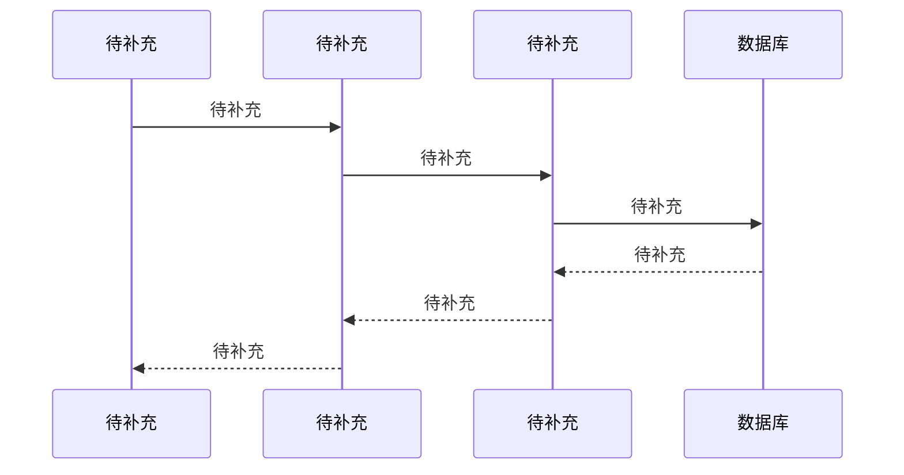

# docs 文档模板

> **这是备份，由 `skills/fullstack-workflow/references/` 下的模板拼回单文件，便于整体阅读。**
> **活版本是 skill 里那些独立文件；这份只是备份，不参与安装。** 两者内容必须一致，改一处要两处一起改。

`docs/` 下每类文档的模板。**照抄结构，内容换成自己的。**

---

## 一、docs/README.md

**回答**：现在有哪些需求在做、卡在哪、下一步该谁动。

```markdown
# 项目文档

## 一、本文结论

现在有哪些需求在做、当前卡在哪；三句话说完，别翻下面的表。

| 项 | 值 |
|---|---|
| 在途需求数 | 待补充 |
| 当前版本 | 待补充 |
| 卡在哪 | 待补充 |

## 二、在途需求

**整条链共用一个版本号，写进每份链上产物的文件名。这一行是全项目唯一的版本登记处。**

| 链 | 需求短名 | 当前版本 | 原型 | 页面规格 | PRD | 架构 | 数据库设计 | TD | TR | CR | 状态 | 卡在谁 | 最近更新 |
|---|---|---|---|---|---|---|---|---|---|---|---|---|---|
| PRD<N> | 待补充 | vX.Y.Z | vX.Y.Z | vX.Y.Z | vX.Y.Z | vX.Y.Z | vX.Y.Z | vX.Y.Z | vX.Y.Z | vX.Y.Z | 待评估 | 待补充 | 待补充 |

**同一行的版本必须全部相同。** 有一格不一样，说明有一份没跟着升。

**版本号 = 需求基线，不是修改次数。** 审查返修、补漏、改错别字都不升版本；只有需求范围变了才升。**所以「当前版本」可能几周不变，这是正常的。**

**项目级文档（设计系统、组件规范、需求池、BRD、MRD、产品术语表、项目环境规范、代码规范、测试策略、服务详细情况、部署拓扑、运维手册、发布记录、审查清单，共 14 份）不带版本，靠 `git log` 追历史，文首写「最后更新」。它们不参与这张表。**

**审查报告填「链 vX.Y.Z」**，和这里对不上就是审错对象了。

**这张表按「实际产生顺序」填，不按目录编号填。** `07-审查` 的编号排在最后，但 CR1 在阶段 1 后就落盘——**编号是产物分类，不是时间顺序**。填表时按真实发生的先后写，不要为了让编号看起来整齐而编时间。

## 三、近期发布

| 版本 | 发布日期 | 包含需求 | 回滚点 |
|---|---|---|---|
| vX.Y.Z | 待补充 | 待补充 | 待补充 |

## 四、待补清单

- [ ] 待补充：缺什么、谁在等、卡不卡上线

## 五、状态定义

**状态名带「待」的，都在等人或等审查。** 没往下走就停在那儿。

**只有四道门、六个停点**：停点 1 范围确认 / 停点 2 原型 / 门 1 设计与产品 / 门 2A 方案（代码前）/ 门 2B 实现（CR2 后）/ 门 3 验证与发布。每次审查（CR1/CR2/CR3）通过后才轮到人放行；**2A 不设审查**，人直接看架构与 TD；两个非门停点不写审查报告。

| 状态 | 含义 | 下一环节 | 卡在 |
|---|---|---|---|
| 待评估 | 需求单已进，还没定要不要做 | 编排者定级 | 人 |
| 问询中 | 正在 grill，范围还没定 | 编排者问完写进派发指令 | 人回答 |
| 待范围确认 | 范围问清，等人确认 | 设计 | 人 |
| 设计中 | 原型在生成或人提改中 | 产品 | — |
| 待设计确认 | 原型 + 设计系统 + 页面规格写完 | 产品 | 人 |
| 待产品 | 设计交完，产品在读原型写文档 | CR1 | — |
| 待审查 1 | 阶段 1 产物齐，等 CR1 | 人 | 审查 |
| 待门 1 | CR1 通过，等人放行 | 架构 | 人 |
| 待方案确认 | 架构 + TD 写完，等门 2A（代码未写） | 代码 | 人 |
| 开发中 | 门 2A 已过，代码在写 | CR2 | — |
| 待审查 2 | 代码 + 实现记录写完，等 CR2 | 人 | 审查 |
| 待门 2B | CR2 通过，等人验收 | 测试 | 人 |
| 测试与运维中 | 阶段 3 在写、在跑 | CR3 | — |
| 待审查 3 | 阶段 3 产物齐，等 CR3 | 人 | 审查 |
| 待门 3 | CR3 通过，等人放行 | 上线 | 人 |
| 待上线 | 门 3 已过，等发布窗口 | 推送部署 | 人 |
| 已发布 | 已上线 | 归档 | — |
| 已阻塞 | 缺人、缺信息、缺环境 | 人介入 | 人 |

**「待审查 N」和「待门 N」是两回事。** 前者等审查角色，后者等人的一句「可以」。审查没通过就回原作者，人这一关根本不启动。
```

---
## 二、01-设计/

### 2.1 01-设计系统/01-设计系统.md（**项目级，不带版本**）

**回答**：这个项目的界面长什么样、开发照着能不能做出一致的界面。

````markdown
# 设计系统

> **放行**：待确认 | 已放行 · <放行人> · <日期>
> **最后更新**：<YYYY-MM-DD>

> 令牌来自 OpenDesign，本节记录的是**用法**：为什么是这个值、什么时候用它、什么时候不许用。

## 一、本文结论

用的哪一套、改了几处、开发照着能不能直接用。

| 项 | 值 |
|---|---|
| 设计系统 | 待补充（ID + 名称） |
| 定制项 | 待补充：无 / 改了 N 项，见第四节 |
| 能不能直接用 | 待补充：能 / 缺哪几项定义 |

## 二、设计方向

**散文，三到五句。这一节回答「为什么是这个样子」，不是「用了什么」。**

待补充：
- 参考了谁（具体的站或产品，不是「现代简约」这种形容词）
- 为什么选它（行业接近 / 受众熟悉 / 人指定）
- **刻意不抄的部分**是什么，为什么
- 我们要加而它没有的是什么

> **示例**
> 参考 Stripe 的文档站与 Linear 的控制台：前者解决「长文怎么读」，后者解决「数据怎么扫」。
> 刻意不抄 Stripe 的大圆角与渐变——这是账务工具，装饰会削弱数字的可信度。
> 要加的是「四态切换器」：每页右上角四个 chip，供走查时切状态。

## 三、设计令牌（可直接落 CSS 变量）

**每个令牌写清三件事**：值、用在哪、为什么是这个值。**只摘开发要用的那几行，不要抄整张令牌表。**

```css
:root {
  --paper:   #F7F6F2;   /* 页面底 */
  --ink:     #0A0A0A;   /* 正文 */
  --ink-2:   #525252;   /* 次级文字 */
  --rule:    #D4D4D0;   /* 分隔线与边框 */
  --surface: #FFFFFF;   /* 卡片底 */
  --ok:      #2F6B4F;   /* 成功 */
  --warn:    #8A5A14;   /* 警告 */
  --error:   #9B2C2C;   /* 错误、删除 */
  --info:    #2C4A6B;   /* 信息 */
}
```

| 令牌 | 值 | 用在哪 | 为什么是这个值 |
|---|---|---|---|
| 页面底 | `--paper` | 全站底色 | 待补充：纯白显廉价 / 与纸媒观感接近 |
| 正文 | `--ink` | 正文、标题 | 待补充：近黑不用纯黑，减眩光 |
| 分隔线 | `--rule` | 卡片边框、表格线 | 待补充 |
| 状态四色 | `--ok / --warn / --error / --info` | **只用于状态** | 待补充：不得做装饰，否则状态失去辨识度 |

**硬约束两条**：

- **颜色一律走变量。** `:root` 之外不出现 `#hex` / `rgb()` / `hsl()`。
- **状态色只表达状态。** 拿它做品牌色或装饰，状态就没人看得懂。

## 四、与通用的偏差

| # | 改了什么 | 原值 | 改成 | 为什么 |
|---|---|---|---|---|
| 1 | 待补充 | 待补充 | 待补充 | 待补充 |

没有偏差就写「无」。

## 五、排版与文案

### 5.1 字号层级

| 用途 | 字体 | 字号 | 字重 | 行高 |
|---|---|---|---|---|
| 页面大标题 | 待补充 | 待补充 | 待补充 | 待补充 |
| 区块标题 | 待补充 | 待补充 | 待补充 | 待补充 |
| 正文 | 待补充 | 待补充 | 待补充 | 待补充 |
| 表格 / 标签 | 待补充 | 待补充 | 待补充 | 待补充 |
| 数字与代码 | 待补充 | 待补充 | 待补充 | 待补充 |

### 5.2 文案规范

| 类别 | 规则 | 示例 |
|---|---|---|
| 错误提示 | **写「你该做什么」，不写「哪里错了」** | ✅「余额不足，请先充值」 ❌「操作失败」 |
| 空态 | 写「为什么空」+ 一个可点的下一步 | ✅「还没有 API 密钥，去创建第一把」 |
| 按钮文字 | 动词开头，不超过 4 字 | ✅「保存」 ❌「点击这里保存数据」 |
| 金额 | 带单位符号，保留两位小数 | ✅「¥1,280.00」 ❌「1280」 |
| 日期 | 全站一种格式，写死 | ✅「2026-11-27」 ❌ 混用几种 |
| 术语 | 与 `02-产品/05-产品术语表` 逐字一致 | ✅「密钥」 ❌ 密钥 / Key / 令牌混用 |

## 六、响应式与可访问性

### 6.1 断点

| 断点 | 宽度 | 布局变化 |
|---|---|---|
| 桌面 | ≥ 1440 | 待补充 |
| 常规 | 1024–1439 | 待补充 |
| 平板 | 768–1023 | 待补充 |
| 手机 | < 768 | 待补充 |

**主宽度写死一个**，其余按实际需要。**窄屏不许横向滚动。**

### 6.2 可访问性基线

| 项 | 要求 |
|---|---|
| 对比度 | 正文 ≥ 4.5:1，大字号 ≥ 3:1 |
| 键盘 | 所有可点元素 Tab 可达，焦点可见 |
| 最小点击区 | ≥ 44 × 44 px |
| 动效 | 尊重 `prefers-reduced-motion`，关掉后功能完整 |

## 七、维护规则

**这份只写跨页复用的东西。**

| 写这里 | 不写这里 |
|---|---|
| 令牌、组件、断点、文案规则 | 单页布局、某页的特殊交互 |
| 全站一致的格式（金额、日期） | 某个页面独有的字段与流程 |

**换设计系统时**：重新生成原型，页面规格跟着更新。**不在旧产物上打补丁——重新生成比修补便宜。**
````

### 2.2 02-组件规范/01-组件规范.md（**项目级，不带版本**）

**回答**：每个跨页复用的控件有哪几种状态、怎么用、什么情况下不许用。

````markdown
# 组件规范

> **放行**：待确认 | 已放行 · <放行人> · <日期>
> **最后更新**：<YYYY-MM-DD>

## 一、本文结论

共几类组件、各类几态、有没有还没定义完的。

| 项 | 值 |
|---|---|
| 组件类数 | 待补充 |
| 已定义齐全的 | 待补充 |
| 还没定义的 | 待补充 |

## 二、通用规则

**所有组件共同遵守的四条，不再逐个重复。**

| # | 规则 |
|---|---|
| 1 | **状态名固定六种**：default / hover / focus / disabled / loading / error。没有的写「不适用」，不许省略 |
| 2 | **focus 必须可见**：键盘 Tab 到时要能看出来，不许 `outline: none` 了事 |
| 3 | **loading 不改尺寸**：宽度高度与 default 一致，防布局跳动 |
| 4 | **disabled 不给 tooltip**：为什么不能点，写在旁边文字里 |

## 三、组件清单

**每个组件一小节，四样缺一不可**：状态矩阵、尺寸、禁止用法、代码位置。

### 3.1 按钮

**状态矩阵**

| 状态 | 视觉 | 可点 | 说明 |
|---|---|---|---|
| default | 待补充 | ✅ | — |
| hover | 待补充 | ✅ | — |
| focus | 待补充 | ✅ | 键盘可达时必须可见 |
| disabled | 待补充 | ❌ | 原因写在旁边 |
| loading | 待补充 | ❌ | 宽度不变 |
| error | 待补充 | ✅ | 只在表单提交后出现 |

**尺寸**：主按钮 `padding: 9px 18px`，字号 14；次按钮同高，白底细线。

**禁止用法**：两个主按钮并排；用危险色做主按钮；按钮里放图标不带文字。

**代码位置**：`src/web/src/components/Button.tsx`

### 3.2 输入框

（同 3.1 的四样。**校验失败的时机写清**：失焦后 / 提交后 / 实时，三选一，不许混。）

### 3.3 表格

（同上。额外写三条：**空表怎么显示**、**超过多少行分页**、**列宽怎么分配**。）

### 3.4 徽标 / 状态 chip

（同上。**颜色与语义必须对应**：哪种状态用哪一色，写死。）

### 3.5 空态 / 错误态 / 加载态

（同上。**这三种态每个页面都要，所以放在这里统一写**，页面规格只引用。）

### 3.6 弹窗 / Toast / 分页

（同上。**没有就删掉这一小节**，不要留空壳。）

## 四、新增组件时

**先加进这份，再在页面里用。** 页面里临时写一个控件、事后再补规范，等于没有规范——三个页面会长出三个版本。
````

### 2.3 03-原型图/

**交付物是一个 HTML 文件：`index.html`。** 目录里还有 `assets/` 和 `.file-versions/`，但 `.html` 只有一个——单文件 + hash 路由，一个文件点通全部页面。

**OpenDesign 直接产出单文件原型：一个 `index.html` + `assets/`，页面用 hash 路由切换。** 跑出来是多个 html 就是没按指令做。

```text
docs/01-设计/03-原型图/
├─ index.html          # ← 原型应用本身（OpenDesign 固定导出名，不要改）
├─ assets/             # 图片等资源，必须一起拷
│  └─ menu/*.jpg
└─ .file-versions/     # 版本快照与 prompt 原文
   └─ <hash>/manifest.json
```

### 2.4 04-页面规格/01-<短名>_页面规格_v<版本>_<日期>.md（**链上，带版本**）

**回答**：每一页要做什么、怎么排、四态各是什么、文案原文是什么。

````markdown
# 页面规格

> **放行**：待确认 | 已放行 · <放行人> · <日期>
> **依据**：`01-设计/03-原型图/index.html` 的实测结果（浏览器量，不是估算）
> **同链**：设计系统 `v<版本>` · 页面规格 `v<版本>` · PRD `v<版本>`

## 一、本文结论

做了几页、四态齐不齐、与原型的缺口几条。

| 项 | 值 |
|---|---|
| 路由数 | 待补充 |
| 四态齐的页数 | 待补充 |
| 缺口条数 | 待补充 |

## 二、跨页统一约定

**每一页都适用，页面小节里不再重复。**

| 项 | 实测值 |
|---|---|
| 页面底色 | 待补充（令牌名 + 实测值） |
| 侧栏宽度 | 待补充 |
| 内容列最大宽 | 待补充 |
| 顶栏高度 | 待补充 |
| 四态切换器位置 | 待补充（如「右上角四个 chip」） |
| 最小支持宽度 | 待补充 |
| 外链数量 | 待补充（应为 0） |

## 三、页面总表

**这一行是导航，也是验收对照表。**

| # | 路由 | 文件 | 屏标识 | 骨架 | 四态 | 1440 高 | 390 溢出 |
|---|---|---|---|---|---|---|---|
| 1 | 待补充 | `p01-xxx.html` | `data-screen="待补充"` | 待补充 | ✅ / — | 待补充 | 待补充 |

**屏标识用产物里的 `data-screen` 值，不是自己编 `p-NN`。** 页面规格与 CR1 的差集都按这一列对齐。

## 四、逐页规格

**每页六节，前三节是散文，后三节是表。** 六节缺一不可。

---

### 4.1 <页面名> `<路由>`（`p01-xxx.html`）

**屏标识**：`data-screen="待补充"`

#### 4.1.1 这页干什么

**散文 2–4 句。** 谁在什么场景下来到这里、要完成什么决定。

> **示例**
> 给还没注册的人看价格，让他判断这站贵不贵。所以 11 张模型卡必须一次看全，不分页
> 分页会让他看不到全貌就关掉。

#### 4.1.2 关键决定

**散文 2–3 句，写「为什么这么排」和「为什么不做另一种」。**

> **示例**
> 卡上显示基准价，不显示折后价。折后价取决于分组，登录后才知道。
> 页头单独一条说明倍率，避免 11 张卡各写一遍。

**没有特别决定的页面写「常规列表页，无特殊决定」。**

#### 4.1.3 字段与控件

| 区块 | 内容 | 校验 / 约束 | 说明 |
|---|---|---|---|
| 待补充 | 待补充 | 待补充 | 待补充 |

**校验时机要写清**：失焦后 / 提交后 / 实时，三选一。

#### 4.1.4 四态

**每一态写「用户看到什么 + 能做什么」，不是只有形容词。**

| 态 | 用户看到什么 | 能做什么 |
|---|---|---|
| 正常 | 待补充 | 待补充 |
| 空 | 待补充 | 待补充（应有一个可点的下一步） |
| 加载 | 待补充 | 待补充（应能取消或至少不卡死） |
| 错误 | 待补充（文案原文） | 待补充（重试 / 联系谁 / 去别处） |

**空态与错误态必须有下一步动作。** 只写「加载失败」等于让用户卡死。

#### 4.1.5 交互与跳转

| 触发 | 行为 | 去哪 / 结果 |
|---|---|---|
| 待补充 | 待补充 | 待补充 |

#### 4.1.6 本页文案原文

**用户可见文字，逐条列出，可直接复制给开发。**

| 位置 | 文字原文 |
|---|---|
| 页面标题 | 待补充 |
| 主按钮 | 待补充 |
| 空态提示 | 待补充 |
| 错误提示 | 待补充 |

**文案写法和术语一致性见 `01-设计/01-设计系统/01-设计系统.md` 第五节，这里只放原文，不重复规则。**

---

### 4.2 <页面名> `<路由>`（`p02-xxx.html`）

（同 4.1 的六节。**每加一个页面，编号顺延一节**，写满产物里的全部 `data-screen`。）

## 五、缺口清单

**「原型有 PRD 缺」与「PRD 有原型没做」都在这里。** 这是 CR1 差集的输入。

### 5.1 原型有、PRD 缺

| # | 页面 | 原型上有什么 | PRD 缺什么 | 处置 |
|---|---|---|---|---|
| 1 | 待补充 | 待补充 | 待补充 | 补 PRD / 标非 PRD 错误码 / 留到下版 |

### 5.2 PRD 有、原型没做

| # | 页面 | PRD 要求什么 | 原型没做什么 | 处置 |
|---|---|---|---|---|
| 1 | 待补充 | 待补充 | 待补充 | 改非目标 / 补原型 |

### 5.3 留到下版

| # | 缺口 | 为什么这版不做 |
|---|---|---|
| 1 | 待补充 | 待补充 |

## 六、与产物的对应关系

| 要看 | 去哪 |
|---|---|
| 一页长什么样 | `01-设计/03-原型图/index.html`（或用浏览器打开对应文件） |
| 一页的字段与文案 | 本文第四节对应小节 |
| 四态怎么切 | 页面右上角四个 chip，或 URL 加 `?state=empty` |
| 设计令牌 | `01-设计/01-设计系统/01-设计系统.md` 第三节 |
| 控件状态矩阵 | `01-设计/02-组件规范/01-组件规范.md` 第三节 |
| 规则与验收 | `02-产品/04-PRD产品需求/<需求编号>/01-*.md` |
````


## 三、02-产品/

### 3.1 01-需求池/01-需求池清单.md（**项目级，不带版本**）

**回答**：还没立项的需求有哪些、为什么做或不做了。

````markdown
# 需求池

> **最后更新**：<YYYY-MM-DD>

## 一、本文结论

池里有几条、几条值得做、几条已否决。

| 项 | 值 |
|---|---|
| 待评估 | 待补充 |
| 已接纳 | 待补充 |
| 已否决 | 待补充 |

## 二、待评估

| # | 日期 | 短名 | 来源 | 状态 | 理由 | 重评条件 |
|---|---|---|---|---|---|---|
| 1 | 2026-11-27 | 导出对账单 | 财务反馈 | 待澄清 | 现在每月手工拼表，约 4 小时 | — |
| 2 | 2026-11-27 | 供应商评论写入口 | 运营 | 待评审 | 只读展示，问的人多 | 出现运营侧真实需求时 |

## 三、已接纳（还没排期）

| # | 日期 | 短名 | 来源 | 状态 | 理由 | 重评条件 |
|---|---|---|---|---|---|---|
| 3 | 2026-11-20 | 批量吊销 Key | 客服 | 已接纳 | Key 泄露时需要一把把点 | — |

## 四、已否决

| # | 日期 | 短名 | 来源 | 状态 | 理由 | 重评条件 |
|---|---|---|---|---|---|---|
| 4 | 2026-11-15 | 邀请返利 | 运营 | 已否决 | 本版不做增长玩法，会拉长合规审查 | 真运营且有推广预算时 |

## 五、已立项

| # | 日期 | 短名 | 需求编号 | 立项日期 |
|---|---|---|---|---|
| 5 | 2026-11-20 | 供应商大厅 | PRD1 | 2026-11-25 |
````

### 3.2 02-BRD商业需求/01-BRD商业需求.md（**项目级，不带版本**）

**回答**：这东西为什么要存在、什么情况下该停。

```markdown
# 商业需求

> **放行**：待确认 | 已放行 · <放行人> · <日期>
> **最后更新**：<YYYY-MM-DD>

## 一、本文结论

这个产品为什么值得投、要投多少、什么条件下该停。

| 项 | 值 |
|---|---|
| 要解决什么 | 待补充 |
| 投入 | 待补充 |
| 停止条件 | 待补充 |

## 二、要解决什么

待补充：谁在什么场景下遇到什么问题，现在怎么凑合，代价是多少。

## 三、为什么现在做

**写「什么变了」，不写「功能有什么」。**

| 项 | 内容 |
|---|---|
| 什么变了 | 待补充（市场 / 政策 / 竞品 / 内部能力） |
| 现在不做会怎样 | 待补充：损失多少（钱、时间、机会） |
| 为什么不是明年做 | 待补充 |

## 四、成功长什么样

| 指标 | 现在 | 目标 | 怎么测 |
|---|---|---|---|
| 待补充 | 待补充 | 待补充 | 待补充 |

## 五、停止条件

满足任一条就停：

- 待补充：可观测的条件
- 待补充：可观测的条件

## 六、谁投了什么

| 投入 | 说明 |
|---|---|
| 人力 | 待补充 |
| 资金 | 待补充 |

```

### 3.3 03-MRD市场需求/01-MRD市场需求.md（**项目级，不带版本**）

**回答**：谁需要、现在怎么解决、为什么不用现成的。

```markdown
# 市场需求

> **放行**：待确认 | 已放行 · <放行人> · <日期>
> **最后更新**：<YYYY-MM-DD>

## 一、本文结论

这个问题有多少人遇到、现在怎么凑合、值不值得做。

| 项 | 值 |
|---|---|
| 目标人群 | 待补充 |
| 现有替代 | 待补充 |
| 值不值得 | 待补充 |

## 二、谁有这个问题

- **待补充（角色）**：人数、场景、现在卡在哪
- **待补充（角色）**：同上

## 三、现在怎么解决

| 现有方案 | 好在哪 | 差在哪 |
|---|---|---|
| 待补充 | 待补充 | 待补充 |

## 四、为什么不用现成的

**核心判断：待补充（用户会为这个差异改变行为吗？）**

待补充：给出具体场景或数字，说明现有方案为什么解决不了。

**如果只是要待补充，现成方案够用，我们不该做这个产品。**

## 五、会不会有人买单

- 决策链：待补充
- 替代成本：待补充
- 付费意愿：待补充

```

### 3.4 04-PRD产品需求/<需求编号>/01-<短名>_PRD_v<版本>_<日期>.md（**链上，带版本**）

**回答**：这一版做什么、系统按什么规则运行、怎么算做完。

```markdown
# <需求短名> · PRD v<版本>

> **PRD<N>** · PRD · vX.Y.Z（**链版本**）· <YYYY-MM-DD>
> **审查**：待审查 | 已通过（CR1）| 有条件通过（未决 P2 <N> 条）| 退回修改
> **放行**：待确认 | 已放行 · <放行人> · <日期> | 已放行（代答 K 项，人未复核）| 未采信：零问询
> **问询**：轮次 N / 未回答 M / 代答 K
> **上游**：编排者的派发指令（范围与约束，不落文件）+ `docs/01-设计/03-原型图/index.html`
> **下游**：待补充

## 一、本文结论

这一版交付什么、不交付什么、多少条可验收。

| 项 | 值 |
|---|---|
| 本期交付 | 待补充 |
| 非目标数 | 待补充 |
| AC 数 | 待补充 |

## 二、背景与目标

**这一节回答「为什么做这一版」，不写要做什么功能。**

| 项 | 值 |
|---|---|
| 承接的 BRD/MRD 指标 | 待补充（写编号与指标，不是「提升体验」） |
| 本版做到哪一步 | 待补充 |
| 不做会怎样 | 待补充 |

## 三、范围

**一句话说清从哪开始、到哪结束。**

待补充。

**范围的边界要能被测试判死**：写「用户可以导出订单」不合格，要写「哪些订单、哪几列、上限多少」。

## 四、非目标（本期不做）

| 不做的事 | 为什么 | 什么时候可能做 |
|---|---|---|
| 待补充 | 待补充 | 待补充 |

## 五、用户故事

> 作为 <角色>，我想要 <做什么>，以便 <得到什么价值>。

| 编号 | 用户故事 | 覆盖的规则 |
|---|---|---|
| US-1 | 作为待补充，我想要待补充，以便待补充 | R-01 / R-05 |
| US-2 | 同上 | R-02 |

**每条用户故事都要指到至少一条规则。** 指不到的，说明这条故事没有落地的地方。

## 六、业务规则

### 6.1 规则清单

| 编号 | 规则（可验证） |
|---|---|
| R-01 | 待补充 |

**每条规则必须能写成一条 AC。** 写不成 AC 的，不是规则，是愿景——删掉或降级成「非目标」。

### 6.2 状态流转

| 从 | 到 | 谁触发 | 条件 |
|---|---|---|---|
| 待补充 | 待补充 | 待补充 | 待补充 |

**每张状态表都要写三样**：有哪些终态、终态能否撤回、非法迁移返回什么码。**只画正常路径的状态图不能用**——真实事故都发生在驳回与撤回上。

### 6.3 字段规则

| 字段 | 必填 | 长度 | 格式 | 唯一 |
|---|---|---|---|---|
| 待补充 | 是 | 待补充 | 待补充 | 否 |

**跨表的不变量写在这里**：如「可用额度 ≥ 0」「冻结额 + 已结算 ≤ 充值总额」。库层能不能拦、谁在保证，都要写清。

## 七、验收标准

**每条 AC 写三样**：前置条件 / 执行动作 / 判定阈值。**带数值的必须给具体算例。**

**每条 AC 标出它覆盖的规则号与用户故事号**（`[R-01][US-1]`），供 TP 反查。

- [ ] AC-01 [R-01][US-1] 待补充：前置 → 动作 → 阈值 — auto:`<测试文件路径>:<行号>`
- [ ] AC-02 [R-05][US-2] 待补充：金额算例写死（如 `62.668800`）— manual:`<谁验、怎么验、证据是什么>`
- [ ] AC-03 [R-09] 待补充 — 未验证（写原因）

**三条硬要求**：

| # | 要求 | 不合格的写法 |
|---|---|---|
| 1 | 能直接写成测试用例 | 「用户可以导出订单」 |
| 2 | 带数值的给算例 | 「金额正确」 |
| 3 | 标出覆盖的 R 与 US | 只写 AC 编号 |

**三种状态标记**：`[x]` 已验证并附证据、`[ ]` 未验证（必须写原因或验证方式）、`draft:` 有草案未跑。

## 八、依赖与约束

| 类型 | 内容 |
|---|---|
| 外部系统 | 待补充 |
| 数据 | 待补充 |
| 时间 | 待补充 |
| 合规 | 待补充 |

**每个外部依赖都要写「它挂了怎么办」。** 没有降级方案的依赖，上线第一天就会变成事故。

## 九、开放问题

| 问题 | 找谁定 | 什么时候要定 | 不定会怎样 |
|---|---|---|---|
| 待补充 | 待补充 | 待补充 | 待补充 |

**带「不定会怎样」这一列**：没有代价的开放问题，只是好看，没人会去定。

## 十、变更历史

| 版本 | 日期 | 改了什么 | 依据 |
|---|---|---|---|
| v1.0.0 | <YYYY-MM-DD> | 初版 | PRD<N> |
| v1.0.0 | <YYYY-MM-DD> | 修 CR1 的 P0-1/P0-2 | CR1 |
| v1.1.0 | <YYYY-MM-DD> | **新增退款流程**（需求变更） | 用户 |
```

### 3.5 05-产品术语表/01-产品术语表.md（**项目级，不带版本**）

**回答**：一个概念只允许一个叫法。

```markdown
# 产品术语表

> **放行**：待确认 | 已放行 · <放行人> · <日期>
> **最后更新**：<YYYY-MM-DD>

## 一、本文结论

一个概念一个叫法；共几个词，哪些是本项目专有。

| 项 | 值 |
|---|---|
| 术语数 | 待补充 |
| 专有词 | 待补充 |
| 与行业用法的差异 | 待补充 |

## 二、术语表

| 术语 | 定义 | 不是什么 | 代码里的名字 |
|---|---|---|---|
| 待补充 | 待补充 | 待补充 | `待补充` |

```

---
## 四、03-架构/

### 4.1 01-系统架构/01-<短名>_系统架构_v<版本>_<日期>.md（**链上，带版本**）

**回答**：为了实现这个原型，技术上怎么搭。**这张文档只放文字、模块清单和流程时序图**；架构总览与系统上下文在 `03-架构/02-架构图示/01-<短名>_总览_v<版本>.html`，状态机在 `03-架构/03-状态机/`。

````markdown
# 系统架构

> **审查**：待审查（随 CR2 在代码后）| 已通过（CR2）| 退回修改
> **放行（门 2A，代码前）**：待确认 | 已放行 · <放行人> · <日期>

## 一、本文结论

分几层、几个模块、三条质量目标各是什么数。

| 项 | 值 |
|---|---|
| 层数 | 待补充 |
| 内部模块 | 待补充 |
| 质量目标 | 待补充 |

## 二、定位与质量目标

待补充：一句话说清这套系统解决什么。

| # | 质量目标 | 数字 | 怎么验证 |
|---|---|---|---|
| 1 | 待补充 | 待补充 | 待补充 |
| 2 | 待补充 | 待补充 | 待补充 |
| 3 | 待补充 | 待补充 | 待补充 |

**只立能用数字判死的目标。** 「高性能」「稳定」不是目标；「复算偏差 0.000000」「UPDATE 被拒率 100%」是。**判不死的需求交给 AC，不占这三条名额。**

## 三、架构总览

待补充：分几层，一句话说清每层职责。

**逻辑架构图与系统上下文图都在 `03-架构/02-架构图示/01-<短名>_总览_v<版本>.html`**，这里只写分层说明。

**每层一句话写清「是不是真隔离」**：进程内模块调用不是隔离，网络边界才是。写错这一列，后面所有安全假设都建立在错的前提上。

## 四、模块清单

| # | 模块 | 职责 | 对外接口 | 代码位置 |
|---|---|---|---|---|
| 1 | 待补充 | 待补充 | 待补充 | `src/待补充` |

**所有源码都要能落到某个模块里。** 落不进去，说明模块划分有漏洞。

**跨模块只能调对方的对外接口，不许直接读对方的表或内部函数。** 违反就是架构禁令，CR2 会按这条查。

## 五、核心流程

待补充：几条关键链路，每条**一张只画正常路径的时序图** + **一张失败分支表**。

### 5.1 待补充



**失败分支**

| 步 | 失败条件 | 返回 | 副作用 |
|---|---|---|---|
| 待补充 | 待补充 | 待补充 | 待补充 |

| 项 | 内容 |
|---|---|
| 事务边界 | 待补充 |
| 失败点 | 待补充 |
| 幂等 | 待补充 |

## 六、状态机

**图在 `03-架构/03-状态机/01-<实体>_状态机_v<版本>.html`（每个实体一张，文件名带序号与版本），这里只写文字定义。**

**每个有 `status` 列的实体各写一张表**，不许只写订单：

| 实体 | 状态数 | 终态 | 图文件 |
|---|---|---|---|
| 待补充 | 待补充 | 待补充 | `03-架构/03-状态机/01-<实体>_状态机_v<版本>.html` |

**这张表是状态机图的唯一导航。** 有哪几张、编号顺序是什么，全在这里；不建 `03-架构/03-状态机/index.html`。

**合法迁移**（每个实体一张，逐条写「从 → 到，什么条件」）：

| 实体 | 从 | 到 | 条件 | 谁触发 |
|---|---|---|---|---|
| 待补充 | 待补充 | 待补充 | 待补充 | 待补充 |

**非法迁移**：一律抛错，不静默忽略。

**终态**：待补充（列出全部，且确认无出边）。

**终态判据写死**：终态栏所列状态，在「从」列里不许再出现。**一条违反就是状态机漏了终态。**

## 七、非功能设计

| 项 | 做法 | 出问题时的兜底 |
|---|---|---|
| 性能 | 待补充 | 待补充 |
| 熔断与重试 | 待补充 | 待补充 |
| 降级 | 待补充 | 待补充 |
| 容量 | 待补充 | 待补充 |

**每一行都要有兜底。** 只写目标不写兜底，等于把事故留给上线后的运维。

## 八、风险与技术债

| 编号 | 问题 | 影响 | 计划 |
|---|---|---|---|
| RK-01 | 待补充 | 待补充 | 待补充 |

**风险要编号**（`RK-NN`），TD 与 TR 都按这个号引用。不编号的风险，写完了没人跟。

````

### 4.2 02-架构图示/01-<短名>_总览_v<版本>.html（**链上，带版本**）

**这份图的「放行」跟随 `03-架构/01-系统架构/01-<短名>_系统架构_v<版本>_<日期>.md` 的门 2A**，html 自身不单设放行行。

**由 Archify 生成，单个自包含 HTML，`architecture` 类型。**

**这张图同时讲两件事**：内部模块怎么分层、外部系统怎么连。外部系统用 `external` 类型，放在边界框外。

| 要求 | 说明 |
|---|---|
| 节点数 | **8–12 个**，超过就拆图 |
| 画布宽 | ≤ 1240px（宽高比 ≥ 1.55 时可到 1790px） |
| 节点类型 | 只能选：`frontend` `backend` `database` `cloud` `security` `messagebus` `external` |
| 边界 | `region` 或 `security-group`，必须表达真实隔离，不能只是把节点框起来 |
| 连线语义 | `emphasis` 主路径、`security` 策略/权限、`dashed` 异步、`default` 普通依赖 |
| 卡片 | 补充读者会问的问题，**不替代拓扑** |
| 交叉 | `visualReviewRecommendation` 信号为 0，或已按 hints 修过 |

**超过 12 节点时拆成目录，按「总览 + 域」分：**

```text
docs/03-架构/02-架构图示/
├─ 01-<短名>_总览_v<版本>.html          ← 只画分层与外部系统边界，不点具体模块
├─ 02-<域>_模块与依赖_v<版本>.html      ← 一个域一张，画该域模块与依赖
└─ 03-<域>_模块与依赖_v<版本>.html
```

### 4.3 03-状态机/ —— 每个有状态列的实体一张（文件名 `01-<实体>_状态机_v<版本>.html`）

**这些图的「放行」跟随 `03-架构/01-系统架构/01-*.md` 的门 2A**，html 自身不单设放行行。

**由 Archify 生成，`lifecycle` 类型。**

**每个有状态的实体一张图，不合并。**。

```text
03-架构/03-状态机/
├─ 01-订单_状态机_v<版本>.html
├─ 02-发货单_状态机_v<版本>.html
├─ 03-售后单_状态机_v<版本>.html
└─ 04-退款单_状态机_v<版本>.html
```

**和架构图示是两个文件，不能合成一个**——两者的 schema 完全不同（`components` vs `states`），一次 `finalize` 只能出一种。

| 字段 | 要求 |
|---|---|
| `mainPath` | 主流程的状态顺序，单独列出来；渲染器靠它排位置 |
| `states[].type` | 只能取：`start` `active` `waiting` `decision` `success` `failure` `neutral` `external` |
| `transitions` | 每条写 `from` / `to` / `label`；可恢复的失败要有真实回退迁移 |
| 终态 | 必须标出，且不再有出边 |

### 4.4 04-项目环境规范/01-项目环境规范.md（**项目级，不带版本**）

**回答**：三套环境（本地开发、测试、生产）分别怎么配，差异只允许出现在一张表里。

**判断标准**：新人照着能跑起本地，运维照着能对上测试与生产；除了差异表，三套必须一致。

````markdown
# 项目环境规范

> **放行**：待确认 | 已放行 · <放行人> · <日期>
> **最后更新**：<YYYY-MM-DD>

## 一、本文结论

几套环境、各在哪、本地怎么起来。

| 项 | 值 |
|---|---|
| 环境数 | 待补充 |
| 本地依赖 | 待补充 |
| 启动命令 | 待补充 |

## 二、工具版本

**版本精确到小版本号。** 写「Node 22」不够——22.11 与 22.13 在某些依赖解析上有差异。

| 工具 | 版本 | 怎么验证 | 为什么锁这个版本 |
|---|---|---|---|
| 待补充 | 待补充 | `待补充` | 待补充 |

**版本清单必须落成文件，不靠口头约定：**

| 文件 | 作用 |
|---|---|
| `.nvmrc` | Node 版本 |
| `package.json` 的 `engines` | Node 与包管理器下限 |
| `packageManager` 字段 | 包管理器精确版本 |
| `docker-compose.dev.yml` | 各依赖镜像 tag |

**禁止 `latest` 或浮动 tag。** 镜像写 `postgres:16.4`，不写 `postgres:16`。

## 三、端口与服务

### 3.1 本地端口

**一个端口一件事，全项目统一。**

| 服务 | 端口 | 地址 | 说明 |
|---|---|---|---|
| 前端 dev server | 待补充 | 待补充 | 待补充 |
| 后端 API | 待补充 | 待补充 | 待补充 |
| 数据库 | 待补充 | 待补充 | Docker 映射 |

**端口冲突改自己的启动参数，不改这份表。** 改表会让所有人的本地环境不一致。

### 3.2 三套环境的服务地址

| 服务 | 本地 | 测试 | 生产 |
|---|---|---|---|
| 前端 | 待补充 | 待补充 | 待补充 |
| 后端 | 待补充 | 待补充 | 待补充 |
| 数据库 | 待补充 | 待补充 | 待补充 |

## 四、三套环境总览

| 项 | 本地开发 | 测试环境 | 生产环境 |
|---|---|---|---|
| 谁用 | 待补充 | 待补充 | 待补充 |
| 机器 | 待补充 | 待补充 | 待补充 |
| 谁维护 | 待补充 | 待补充 | 待补充 |
| 怎么访问 | 待补充 | 待补充 | 待补充 |
| 数据 | 待补充 | 待补充 | 待补充 |
| 域名 | 待补充 | 待补充 | 待补充 |
| 部署方式 | 待补充 | 待补充 | 待补充 |
| 回滚 | 待补充 | 待补充 | 待补充 |

## 五、变量清单

**变量名与含义的唯一出处是 `docs/06-运维/01-服务详细情况/01-服务详细情况.md` 的「变量清单」。** 这里只写本地怎么填。

| 变量 | 本地值 | 说明 |
|---|---|---|
| 待补充 | 待补充 | 待补充 |

**本地值可以写死在这里，因为它们是公开的。** 真实凭证只在服务器上，`deploy/env/` 整目录不入库。

## 六、环境差异

**差异只允许出现在这张表里。表里没有的项，三套环境必须一致。**

| 项 | 本地开发 | 测试环境 | 生产环境 |
|---|---|---|---|
| 依赖版本 | 待补充 | 待补充 | 待补充 |
| 外部服务 | 待补充 | 待补充 | 待补充 |
| 定时任务 | 待补充 | 待补充 | 待补充 |
| 日志级别 | 待补充 | 待补充 | 待补充 |
| 数据量 | 待补充 | 待补充 | 待补充 |
| 外部访问 | 待补充 | 待补充 | 待补充 |
| 备份 | 待补充 | 待补充 | 待补充 |

## 七、本地依赖启动

**外部依赖用 Docker 起，不要求每个人本机装数据库。**

```yaml
# deploy/docker/docker-compose.dev.yml
services:
  待补充:
    image: 待补充
    ports: ["待补充:待补充"]
    environment:
      待补充: 待补充
volumes:
  待补充:
```

**启动顺序**：待补充。后端启动时检查数据库连接，连不上直接退出并打印连接串。

## 八、代码风格工具

**工具配置即规范，不写进文档正文。**

| 工具 | 管什么 | 配置文件 |
|---|---|---|
| Prettier | 缩进、引号、换行 | `.prettierrc` |
| ESLint | 语法、潜在 bug、import 顺序 | `eslint.config.js` |
| TypeScript | 类型严格度 | `tsconfig.json` 的 `strict: true` |
| commitlint | 提交信息格式 | `commitlint.config.js` |
| lint-staged | 提交前检查 | `package.json` |

**不抄缩进几个空格。** 抄一份必然和配置文件漂移。

````

### 4.5 05-数据库设计/01-<短名>_数据库设计_v<版本>_<日期>.md（**链上，带版本**）

**回答**：这个库存什么、每张表怎么设计、什么规则库管不了、怎么改才安全。

````markdown
# 数据库设计

> **审查**：待审查 | 已通过（CR2）| 退回修改
> **放行（门 2A，代码前）**：待确认 | 已放行 · <放行人> · <日期>

## 一、本文结论

几张表、几条不变量、能不能退。

| 项 | 值 |
|---|---|
| 物理表 | 待补充 |
| 不变量 | 待补充（`INV-01`…`INV-<N>`） |
| 能不能退 | 待补充：每个迁移都有 down，或写出哪个不可逆 |

**「能不能退」这一格必须填具体的。** 写「可回滚」不算——要写「9 个迁移全部有 down SQL，其中 `0005` 的回滚会丢数据，需先备份」。

## 二、全局约定

**所有表共用的约定，写一次，逐表不再重复。这一节错了，后面每条 SQL 都要改。**

| 项 | 约定 | 为什么 |
|---|---|---|
| 数据库与版本 | 待补充 | 待补充（如「依赖 PG 15+ 的部分唯一索引」） |
| 字符集与排序 | 待补充 | 待补充（如「`lc_collate=C`，避免排序随机器 locale 变化」） |
| 主键策略 | 待补充 | 待补充（如「实体表 `id UUID`，流水表用业务号」） |
| 时间 | 待补充 | 待补充（如「`timestamptz` UTC 存，展示按 `Asia/Shanghai`」） |
| **金额精度** | 待补充 | 待补充（如「元 `numeric(14,2)`；quota `numeric(18,6)`」） |
| 连接账号与权限 | 待补充 | 待补充（如「迁移角色有 DDL，应用角色无 UPDATE 权限」） |
| 迁移工具与执行方式 | 待补充 | 待补充（如「golang-migrate；启动不自动迁移，部署脚本显式调用」） |

**结构与含义分开写**：字段类型在迁移文件里；枚举含义、单位、时区、不变量只在本文。

## 三、表清单

**一张表一行。这张表是导航，也是 schema 变更的责任表。**

| # | 表 | 一行代表什么 | 归属模块 | 当前行数 | 年增长 | 会不会删 |
|---|---|---|---|---|---|---|
| 1 | 待补充 | 待补充 | 待补充 | 待补充 | 待补充 | 待补充 |

**「归属模块」不能空。** schema 变更要知道找谁批——Janus 那种 26 张表、跨 10 个模块的项目，没有这一列就没人认领。

## 四、逐表设计

**每张表一节，五样缺一不可**：字段表、枚举表、索引、设计理由、与上游不一致处。

**表多的按模块分组建节**（如「4.1 账号与供给」「4.2 计费与用量」），不按字母表排。

---

### 4.1 <表名>

**一句话**：待补充：这张表存什么、谁往里写、谁读。

#### 4.1.1 字段

| 字段 | 类型 | 约束 / 默认 | 说明 |
|---|---|---|---|
| 待补充 | 待补充 | 待补充 | 待补充 |

**说明列只写「从字段名看不出来的」**：归属关系、单位、谁改它、为什么这个类型。**能看懂的不要写。**

#### 4.1.2 枚举值

**枚举必须列全含义，不写「见状态机」。**

| 值 | 中文含义 | 谁能改到它 |
|---|---|---|
| 待补充 | 待补充 | 待补充 |

#### 4.1.3 索引

**每个索引都要说出服务于哪条查询。说不出就不要建，写了中期会变成维护负担。**

| 索引 | 字段 | 服务的查询 | 为什么这样排 |
|---|---|---|---|
| 待补充 | 待补充 | 待补充 | 待补充 |

**部分唯一索引的 `WHERE` 子句必须与状态机一致。** 状态机改了、`WHERE` 没改，唯一性会突然放开——这是最难查的一类 bug。

#### 4.1.4 设计理由

**散文一两句**：为什么这样拆、为什么不用另一种。

> **示例**
> 资金账本只增不改：唯一出口是 `FundsLedger.Append()`，应用角色**没有** UPDATE / DELETE 权限。
> 不用「余额字段 + 流水」两表，因为两者必然对不上，而对不上时无法判断哪个是对的。

#### 4.1.5 与上游不一致处

**PRD 说的和这里做的对不上时，写清「上游怎么写、这里怎么做、为什么」，并写进架构的差异清单。**

| 上游怎么写 | 这里怎么做 | 为什么 |
|---|---|---|
| 待补充 | 待补充 | 待补充 |

没有不一致就写「无」。**这一栏不写，后人会按上游那个错的版本改回来。**

---

### 4.2 <表名>

（同 4.1 的五样。）

## 五、跨表约束与不变量

**数据库约束表达不了的规则。不写，改代码的人不知道这些必须成立。**

| # | 不变量 | 谁在保证 | 违反会怎样 |
|---|---|---|---|
| INV-01 | 待补充 | 待补充 | 待补充 |

**不变量要编号**（`INV-NN`），TR 的不变量探针按这个号逐条打红。**只写「有约束」不写编号，测试就不知道要验几条。**

**每条都要写「谁在保证」**：库约束、应用层、定时任务、还是人工。写「应用层」的，说明库拦不住——改代码的人必须知道这一点。

## 六、数据分类与保留

| 表 / 字段 | 是不是个人信息 | 保留期 | 到期怎么处理 |
|---|---|---|---|
| 待补充 | 待补充 | 待补充 | 待补充 |

**软删还是硬删**：待补充。
**删除请求怎么处理**：待补充。
**导出包含哪些**：待补充。

## 七、迁移与回滚

**每个迁移必须写清五段：改什么、影响多少行、锁多久、兼容窗口、怎么退。**

| 迁移文件 | 改什么 | 影响行数 | 预计锁 | 耗时 |
|---|---|---|---|---|
| `0001_*.up.sql` | 待补充 | 待补充 | 待补充 | 待补充 |

**兼容窗口**：

| 迁移 | 旧代码能读新表吗 | 新代码能读旧数据吗 | 窗口多久 |
|---|---|---|---|
| 待补充 | 待补充 | 待补充 | 待补充 |

**回滚**：

| 迁移 | 回滚命令 | 回滚后数据 |
|---|---|---|
| 待补充 | 具体 SQL | 待补充 |

**回滚触发条件**：待补充：写成数字，例如 5xx 占比、P95 耗时。

**回滚前必须验证 down 迁移能跑通。** 只在测试库跑一次 up 不算验证。

## 八、容量与大表演进

| 表 | 当前 | 12 个月后 | 36 个月后 | 什么时候要动 |
|---|---|---|---|---|
| 待补充 | 待补充 | 待补充 | 待补充 | 待补充 |

**大表改动方案**：待补充：超过多少行后 ALTER 会锁表，改为怎样的五步走（加可空列 → 双写 → 回填 → 切读 → 删旧列）。

## 九、与 ER 图的对账

**ER 图在 `03-架构/06-ER图/`（`erd` 类型，table-first，含全部物理字段），恒为目录，不建 `index.html`。**

**对账只有一条判据**：`schema` 里的每张表，要么出现在某张 ER 图里，要么在 `03-架构/06-ER图` 的缺口清单里写明为什么没画。

**怎么核对**：从 `schema` 抽表名，与各图 JSON 的 entity `id` 做差集；差集必须为空，或差集里每个表都有缺口记录。

| 项 | 值 |
|---|---|
| 本版物理表 | 待补充 |
| 图上覆盖 | 待补充 |
| 缺口 | 待补充：无 / N 张，清单见 `03-架构/06-ER图/` |

````


### 4.6 06-ER图/ —— 一张 8–12 表（文件名 `01-<域>_ER图_v<版本>.html`）

**这些图的「放行」跟随 `03-架构/01-系统架构/01-*.md` 的门 2A**，html 自身不单设放行行。

**由 Archify 生成，table-first，显示每一个物理字段。** 不是「挑几个重要字段画一画」。

| 要求 | 说明 |
|---|---|
| 字段 | **全部物理列**，一个不漏 |
| 类型 | SQL 类型照实写（`bigserial`、`varchar(32)`、`timestamptz`） |
| 主外键 | `key` 取 `pk` / `fk` / `uk`；联表列写 `["pk","fk"]` |
| 外键指向 | 每个 `fk` 列都要 `references`，**且用 entity 的 `id` 不是表名**：`"user.id"` ✅ / `"users.id"` ❌ |
| 域分组 | 按功能域打 `tag`，且**同一张表必须同时写 `row` / `col`** |
| 空值 | 可空列标出来 |

**`references` 写错是最高频失败**：`label` 是全复数表名（`users`），`id` 是单数（`user`），`references` 只认 `id`。写错报 `layout/constraint | references unknown entity`。

**`row` / `col` 是硬要求，不是可选项。** 打了 `tag` 的表没有网格坐标就没法算色块范围，渲染器直接报 `erd/domain-not-drawn`。一个域的成员只能排成**一行、一列或实心矩形块**，不能 L 形或斜线。

**多域时一个域占一列最好读**——横向铺开会被缩放，纵向拉长反而保证完整。

```bash
node ~/.agents/skills/archify/bin/archify.mjs finalize erd \
  candidate.json 03-架构/06-ER图/01-<域>_ER图_v<版本>.html --quality standard --json \
  --out-dir docs/99-tmp/架构-<任务>/03-receipts/
```

**超过 8 张表或 50 个字段时，第一遍用 `--quality standard`。** 只有布局仍然读得清时才升 `showcase`——别一上来追高，也不无限重试。

**一次只画 8–12 张表：超出必须拆成多个图文件**

**Archify 的硬约束：一次 `finalize` 只出一个 `<svg>`，8–12 个 entity 是单屏可读上限。** 22 张表塞一张里，字号会掉到读不清。

**正确处理是拆，不是「只画主干」。**

```text
03-架构/06-ER图/
├─ 01-账号与商品_ER图_v<版本>.html    （user / spu / sku / sku_spec / warehouse / stock / stock_ledger）
├─ 02-订单与发货_ER图_v<版本>.html    （order / order_line / order_alloc / shipment / shipment_line / import_log）
└─ 03-售后与审计_ER图_v<版本>.html    （after_sale / after_sale_alloc / refund / audit_log / session / doc_*）
```

### 4.7 07-ADR重要决策/ADR<N>/01-<短名>_ADR_v<版本>_<日期>.md（**链上，带版本**）

**回答**：为什么当时这么选、放弃过什么、代价是什么。

```markdown
# ADR<N> · <决策短名>

> **ADR<N>** · ADR · vX.Y.Z（**链版本**）· <YYYY-MM-DD>
> **放行**：待确认 | 已放行 · <放行人> · <日期>
> **ADR 状态**：accepted | proposed | superseded · <决定人> · <日期>

## 一、本文结论

选了什么、放弃了什么、代价是什么。

| 项 | 值 |
|---|---|
| 选了什么 | 待补充 |
| 为什么不是另一个 | 待补充 |
| 代价 | 待补充 |

## 二、背景

待补充：不这么干会出什么事。写具体现象，不写「为了提升质量」这种话。

## 三、决定

1. 待补充：可执行、可验证的一条。
2. 待补充
3. 待补充

## 四、代价

- 好：待补充
- 好：待补充
- 坏：待补充（**必须有**）
- 坏：待补充

## 五、放弃过的选项

| 选项 | 做法 | 为什么不选 |
|---|---|---|
| A | 待补充 | 待补充 |
| B | **选中** | — |
| C | 待补充 | 待补充 |
```

---
## 五、04-开发/

### 5.1 01-代码规范/01-代码规范.md（**项目级，不带版本**）

**回答**：这个项目怎么写代码、怎么提交、怎么分分支。新人照着能写出与团队一致的代码。

````markdown
# 代码规范

> **最后更新**：<YYYY-MM-DD>

## 一、本文结论

目录怎么分、怎么提交、哪些禁令不能碰。

| 项 | 值 |
|---|---|
| 分层 | 待补充 |
| 分支模型 | 待补充 |
| 禁令数 | 待补充 |

## 二、仓库与目录

按功能模块分，前后端同名对齐：

```text
src/
├─ frontend/modules/待补充/
├─ backend/modules/待补充/
└─ backend/modules/待补充/
```

| 层 | 负责 | 不负责 |
|---|---|---|
| route | 鉴权、参数校验、调 service | 业务判断 |
| service | 业务规则、事务边界 | 拼 SQL、读 req |
| repo | 数据访问、查询构造 | 业务规则 |

**模块边界**：跨模块只能调对方的 service，不许直接读对方的表。违反就是架构禁令。

**代码放哪个目录，和测试放哪个层，是两件事。** 开发自写的单元测试跟源码放（`src/**/*.test.ts`）；需要真实依赖的进 `test/integration/`；`test/` 归测试角色，不归开发。

**什么进仓库，由 `.gitignore` 决定**，不另写清单。

## 三、Git 初始化与身份

**新机器第一次提交前，必须配这三项：**

```bash
git config --global user.name  "待补充"
git config --global user.email "待补充"
git config --global init.defaultBranch dev
```

| 项 | 要求 | 为什么 |
|---|---|---|
| `user.name` | **真实姓名** | 出问题能追到人 |
| `user.email` | **公司邮箱** | 不用私人邮箱，避免离职后失联 |
| 机器人身份 | **禁止** | `ai-bot@company.com` 这类身份等于无法追责 |

**AI 用当前开发者身份提交。** 责任归让 AI 干活的人，不另造一个机器人账号。

**克隆时必须带 `-b dev`。**

```bash
git clone -b dev <仓库地址>
git branch --show-current   # 必须是 dev
```

**进入任何仓库后先确认分支。** AI 每次开工前跑一次 `git branch --show-current`，不是 `dev` 就先切过去再动手。

## 四、分支模型

三个长期分支，三类短命分支。

| 分支 | 用途 | AI 能直接推 | 谁合并进来 | 部署到 |
|---|---|---|---|---|
| `dev` | 集成；**所有人从这里开始** | ✅ | AI 或人 | —（不跑流水线） |
| `test` | 测试环境，受保护 | ❌ | **只有人** | 测试环境 |
| `prod` | 生产环境，受保护 | ❌ | **只有人** | 生产环境 |
| `feat/<PRD号>-<短名>` | 新功能 | ✅ | — | — |
| `fix/<PRD号>-<短名>` | 该 PRD 实现中的缺陷 | ✅ | — | — |
| `hotfix/<短名>` | 线上故障，来不及走 PRD | ⚠️ 只推 `hotfix/*` | **只有人**合进 `prod` | 生产环境 |

**`fix` 与 `hotfix` 的区别**：

| 项 | `fix/PRD<N>-<短名>` | `hotfix/<短名>` |
|---|---|---|
| 起因 | 该 PRD 的验收没过 | 线上已经在报错 |
| 从哪拉 | `dev` | `prod` |
| 有 PRD 吗 | 有 | **没有**；事后补一份 |
| 合到哪 | `dev` → `test` → `prod` | `prod`，再往回合 `test`、`dev` |

**核心约束：AI 到 `dev` 为止。** `test` 与 `prod` 只有人能合并——既是纪律，也是保护分支的技术限制。

**`hotfix` 必须往回合。** 只合 `prod` 不回 `dev`，下次从 `dev` 发布就会把修复冲掉。

### 4.1 各分支推什么

| 分支 | 推什么 | 为什么 |
|---|---|---|
| `dev` | **整个项目全部内容**（含 `99-归档/` 的历史版本） | 开发本地仓库，**信息必须对等**——别人拉一次就能看到完整历史和所有旧版本，不用回聊天记录里找 |
| `test` | 当前版本 + 当次需要的产物，**不含 `99-归档/`** | 测试环境只跑当前这套；带冗余会拖慢流水线、干扰定位 |
| `prod` | 运行所需内容 + 当次发布快照 | 生产环境最小化，减少误操作面 |

**`99-归档/` 只在 `dev` 上。** 归档是给人和 AI 查历史用的，不是给流水线用的。`test` / `prod` 没有归档不代表归档丢了——它在 `dev` 上完整保留。

**`dev` 是唯一真相源。** 想知道「上一版架构长什么样」，去 `dev`；`test` / `prod` 只有当前版。

**命名规则**：

```text
feat/PRD1-待补充     ✅ PRD 号 + 短名
fix/PRD12-待补充     ✅
hotfix/待补充        ✅ 故障现象，不用 PRD 号
worktree-abc123     ❌ 看不出在做什么
tmp                 ❌ 无信息
feat/待补充（中文）   ❌ 中文、大写都不行
hotfix/PRD13-fix    ❌ hotfix 挂 PRD 号，说明该走 fix
```

**分支纪律**：

- 一个分支只做一件事。
- 存活时间几天内。超过一周说明拆得不够小。
- 同时存在的分支 **不超过 10 个**。
- 合进 `dev` 后立即删除。

**一次改动的完整路径**：

```text
git branch --show-current        # 先确认在 dev
git switch dev && git pull
git switch -c feat/PRD1-待补充
  实现 → 本地跑验证 → git commit
git push origin feat/PRD1-待补充
  合入 dev（AI 可以）
  人合 dev → test          测试角色出 TR
  人合 test → prod         运维出发布记录
```

**`hotfix` 的完整路径**：

```text
git switch prod && git pull
git switch -c hotfix/待补充
  最小修复 → 跑验证 → git commit
git push origin hotfix/待补充
  人开 MR 合 prod            ← 先止血，合完立刻部署
  人合 prod → test           ← 让测试环境与生产一致
  人合 prod → dev            ← 必须回，否则下次发布会冲掉修复
  事后补一份 PRD + 实现记录
```

## 五、提交信息

只写两件事：**完成了什么、动了哪些模块**。

```text
feat(PRD1): 订单审核与库存锁定

改动模块：order、stock、audit
TD：TD1_电商运管平台_v1.1.0
```

type ∈ feat / fix / hotfix / refactor / test / docs / chore。

**动了 `src/` 或 `test/` 的提交必须带 `TD：<编号>` 一行。** 只改文档（`docs/`）的提交不需要。

**这条是硬约束，不是建议。** 提交前自查三件事：

| 检查 | 不通过怎么办 |
|---|---|
| 该 TD 文件存在 | 先写 TD，再提交代码 |
| TD 的落盘时间晚于首个代码提交 | **TD 先落盘，再提交代码**；判据是时间戳，不是放行行 |
| `git log` 里 TD 首次出现**早于** `src/` 首次出现 | **不许后补 TD 再提交**——补了也是在骗校验点 |

**`hotfix` 例外**：线上故障允许先修再补文档，但提交信息必须写 `TD：事后补`，且 24 小时内补上并单独提交一次 `docs: 补 TD<N>`。

**TD 不许后补。** 两道保险：**门 2A 让代码开工前人在纸上先看方案**；时间检查让「TD 落盘早于首个代码提交」变成机器可验的事实。**后补的 TD 填「已放行」也算没放行。**

## 六、命名

| 东西 | 怎么写 | 例子 |
|---|---|---|
| 变量、函数、参数 | lowerCamelCase | 待补充 |
| 类、接口、类型、组件 | UpperCamelCase | 待补充 |
| 常量、枚举值、错误码 | CONSTANT_CASE | 待补充 |
| 前端文件 | 组件 Upper，工具 lower | 待补充 |
| 后端文件 | kebab-case | 待补充 |
| 数据库表、字段 | snake_case | 待补充 |

**缩写当成一个词。** `loadHttpUrl`，不是 `loadHTTPURL`。
**不加类型前缀。** `Contract`，不是 `IContract`。
**布尔用 is / has / can 开头。**
**禁止拼音，禁止词中间删字母。** 用 `message` 不用 `msg`。

````

### 5.2 02-技术方案/<需求编号>/01-<短名>_技术方案_v<版本>_<日期>.md（**链上，带版本**）

**回答**：这个需求在代码里怎么落地。输入是 PRD 加架构约束，输出是实现方案。

````markdown
# TD<N> · <方案短名>

> **TD<N>** · 技术方案 · vX.Y.Z（**链版本**）· <YYYY-MM-DD>
> **审查**：待审查（随 CR2 在代码后）| 已通过（CR2）| 退回修改
> **放行（门 2A，代码前）**：待确认 | 已放行 · <放行人> · <日期>
> **上游**：`02-产品/02-BRD商业需求/01-BRD商业需求.md` 与 `02-产品/04-PRD产品需求/PRD<N>/01-*.md`；架构见 `03-架构/01-系统架构/01-*.md`
> **下游**：代码 + `04-开发/03-实现记录/PRD<N>/01-*_实现记录_*.md`

**TD 先落盘、过门 2A，代码才开工。** 没填 `已放行` 就写代码，CR2 的第一次检查会按时间戳退回。

## 一、本文结论

这份方案分几步、每步怎么算做完、卡点在哪。

| 项 | 值 |
|---|---|
| 步骤数 | 待补充 |
| 工期 | 待补充 |
| 卡点 | 待补充 |

## 二、业务怎么建模

**先把状态和数据想清楚，再写代码。**

### 2.1 状态

待补充：有几个状态、存在哪几个字段、为什么这么分。

| 字段 | 存什么 | 谁改 |
|---|---|---|
| 待补充 | 待补充 | 待补充 |

**合法迁移**（非法组合在状态机层拒绝）：

| 从 | 到 | 触发 |
|---|---|---|
| 待补充 | 待补充 | 待补充 |

### 2.2 数据

| 表 | 存什么 | 关键决定 |
|---|---|---|
| 待补充 | 待补充 | 待补充 |

**关键决定要写理由。** 例如「存提交时快照，不读主表当前值」，理由一句话说清，否则后面会被改回去。

## 三、接口契约

前端照这个写，不用问后端。

### 3.1 `待补充（方法与路径）`

```json
// 请求
{
  "待补充": "待补充"
}

// 200
{ "待补充": "待补充" }

// 4xx
{ "code": "待补充", "message": "待补充" }
```

| 校验 | 失败返回 |
|---|---|
| 待补充 | `待补充` |

**业务判断留在后端。** 前端不复制阈值、不自己算下一步。

## 四、关键逻辑

**这几条是最容易做错的，写清实现方式，不留解释空间。**

| 问题 | 怎么做 | 为什么不能换个做法 |
|---|---|---|
| 待补充 | 待补充 | 待补充 |

## 五、数据改动

| 项 | 内容 |
|---|---|
| 结构变更 | 待补充 |
| 历史数据 | 待补充：多少行、有没有异常、具体数字 |
| 回填脚本 | 待补充：分批多少、能不能重复执行 |
| 回滚 | 待补充 |

**数据改动前的校验 SQL**：

```sql
待补充
```

预期结果：待补充。不符就停。

## 六、实施顺序

**顺序错了会返工。** 每一步做完能跑出一个可验证的结果。

**要并行开发时，本节必须写三样：6.1 分块表、6.2 共享面冻结清单、6.3 每路怎么派怎么合。** 三样缺一，并行就退化成几个 agent 抢同一批文件。

| # | 做什么 | 做完能验证什么 | 依赖 |
|---|---|---|---|
| 1 | 待补充 | 待补充 | — |
| 2 | 待补充 | 待补充 | 1 |

### 6.1 分块表：哪几路能并行

**先判断能不能并行，再排顺序。** 只有「目录不重叠、互不 import、能各自跑测试」的三步才可以并行。

| 路 | 做什么 | 可写（拥有） | 禁区（绝对不许碰） | 验证命令 |
|---|---|---|---|---|
| W1 | 待补充 | `src/backend/internal/待补充/**` | `package.json`、迁移文件、共享类型 | 待补充 |
| W2 | 待补充 | `src/web/src/pages/待补充/**` | 同上 | 待补充 |

**路号 `W<k>` 一路到底不改名**：分块表里叫 `W1`，分支叫 `feat/PRD<N>-W1-<模块>`，实现记录里也标注 `W1`。**回执要对上人，就靠这个号。**

**任意两路的「可写」集合交集必须为空。** 交集非空就不许并行——要么改边界，要么串行。

**禁区那一列不是装饰。** 共享类型、`package.json`、迁移文件、schema、组件 props 是所有路都要读的东西，谁改谁崩别人。

**最多 4 路。** 算出来 5 路以上，说明分块太细或共享面没理清，退回串行重划。

### 6.2 共享面冻结清单

**并行开始前把这些定死，并行期间改动次数必须为 0。**

| 共享面 | 冻结在哪 | 谁定 |
|---|---|---|
| 数据库表结构与迁移文件 | `03-架构/05-数据库设计/01-*.md` + 迁移 `0001` | 架构 |
| 接口签名（路径、入参、出参、错误码） | 本文第三节「接口契约」 | TD |
| 共享类型文件 | `src/common/types.ts`（按项目实际） | TD |
| 前端共享组件 props | `docs/01-设计/02-组件规范/01-组件规范.md` | 设计 |

**判据**：并行期间 `git log --oneline -- <这些文件>` 应为空。有提交就说明契约漂了，全部路停下来，人重新拍板。

**契约变了要回门 2A。** 改共享面 = 改方案，方案变了原来的放行失效。

### 6.3 每路怎么派、怎么合

**派活用四行，不用一段散文：**

```text
目标：<这一路做完，什么算成功>
可写：<目录>
禁区：<清单>
验证：<一条能跑的命令>
```

**合并按依赖顺序，不按编号顺序。** 契约或公共底座那一路先合，其他路 rebase 到它上面；每合一路跑一次测试，不要攒到最后一起跑。

**冲突只有三种处置：**

| 情况 | 处置 |
|---|---|
| 两路改了同一个文件 | 后交的那一路在自己的 worktree 里 rebase，自己解 |
| 有人动了共享面 | 全部路停下，人重新拍板，所有路 rebase |
| 某一路跑不通 | 只回退这一路，其他继续 |

**不许编排者替 agent 解冲突**——它不知道业务，会把两边的错撮合到一起。

**不许并发 `git commit`。** `index.lock` 只允许一把，串行提交。

**每路一个 worktree，独立端口与独立库 schema：**

```bash
git worktree add ../wt-PRD<N>-W1 -b feat/PRD<N>-W1 dev
```

**合并完立刻 `git worktree remove`**，不留残留目录。

## 七、已知的坑

| 坑 | 什么时候会踩 | 打算怎么处理 |
|---|---|---|
| 待补充 | 待补充 | 待补充 |

**回滚触发条件**：待补充：写成数字。
````

### 5.3 03-实现记录/<需求编号>/01-<短名>_实现记录_v<版本>_<日期>.md（**链上，带版本**）

**回答**：实际改了什么、怎么实现的、和方案差在哪。

````markdown
# TD<N> · <方案短名> · 实现记录

> **TD<N>** · 实现记录 · vX.Y.Z（**链版本**）· <YYYY-MM-DD>
> **放行（门 2B，CR2 后）**：待确认 | 已放行 · <放行人> · <日期>
> **上游**：`docs/04-开发/02-技术方案/PRD<N>/01-<短名>_技术方案_v<版本>_<日期>.md`（**填真实路径，不写「见 TD」**）
> **下游**：`02-产品/04-PRD产品需求/PRD<N>/01-*.md` 的 AC + `05-测试/02-测试方案/PRD<N>/01-*.md`

## 一、本文结论

实际改了什么、和方案差在哪、验证过什么。

| 项 | 值 |
|---|---|
| 改动文件数 | 待补充 |
| 偏差数 | 待补充 |
| 检查项 | 待补充 |

## 二、改动清单

每项一句话说清做了什么。

```text
起点 <SHA>（分支首提交）  终点 <SHA>（写完时的 HEAD）
git diff --stat <SHA>..<SHA>
 待补充 files changed, 待补充 insertions(+), 待补充 deletions(-)
```

**记两端 SHA，不记 `dev..分支名`。** 分支合掉就失效，SHA 永远能重算出当时的 diff。

| 改动 | 文件 | 做了什么 |
|---|---|---|
| 待补充 | 待补充 | 待补充 |

## 三、关键实现

**凡是「想了一下才决定」的地方都记下来。**

| 位置 | 怎么实现的 | 为什么这么写 |
|---|---|---|
| 待补充 | 待补充 | 待补充 |

## 四、与方案的差异

**方案说 X，实际做了 Y。没有就整节写「无」。**

| 方案说 | 实际做了 | 为什么 | 上报了吗 |
|---|---|---|---|
| 待补充 | 待补充 | 待补充 | 待补充 |

**方案文档不动。** 要改方案就升版重写，偏差记在这里。

## 五、验证

**必须附真实输出。写「测试通过」等于没写。**

```text
环境：待补充
命令：待补充

输出：
  待补充（原文粘贴）
```

| 跑了 | 结果 |
|---|---|
| 待补充 | 待补充 |
| 待补充 | **未跑**，原因 |

## 六、遗留

| 项 | 类型 | 谁处理 | 去向 | 卡不卡上线 |
|---|---|---|---|---|
| 待补充 | 待补充 | 待补充 | `README.md` 待补清单或 PRD 编号 | 待补充 |

**「去向」只填两种：`README.md` 待补清单，或一个 PRD 编号。** 两条路都没走的遗留等于没有下文。
````

---
## 六、05-测试/

### 6.1 01-测试策略/01-测试策略.md（**项目级，不带版本**）

**回答**：这个项目长期怎么测。项目级，一份，不随需求改。

````markdown
# 测试策略

> **最后更新**：<YYYY-MM-DD>

## 一、本文结论

测什么不测什么、出口标准是什么。

| 项 | 值 |
|---|---|
| 分层 | 待补充 |
| 出口标准 | 待补充 |
| 不测什么 | 待补充 |

## 二、测什么、不测什么

| 覆盖 | 说明 |
|---|---|
| 待补充 | 待补充 |

| 不测 | 原因 | 风险谁承担 |
|---|---|---|
| 待补充 | 待补充 | 待补充 |

**每条排除都要写「风险谁承担」。** 只写「不测」不写风险归属，出问题时没人认。

## 三、分层与归属

| 层 | 目录 | 工具 | 抓什么 | 谁写 | 耗时上限 |
|---|---|---|---|---|---|
| 单元（含组件） | `test/unit/` | 待补充 | 待补充 | 全栈开发，随代码一起 | 待补充 |
| 集成 | `test/integration/` | 待补充 | 待补充 | 测试角色 | 待补充 |
| 端到端（含视觉、a11y） | `test/e2e/` | 待补充 | 待补充 | 测试角色 | 待补充 |
| 压力 | `test/perf/` | 待补充 | 待补充 | 测试角色，按需 | 按需 |
| 移动端 | `test/mobile/` | 待补充 | 待补充 | 测试角色，按需 | 按需 |

**「层」这一列必须与 `test/` 的目录名逐字一致**，否则报告说「集成层挂了」，人得换算才知道是哪条命令。

**单元和组件归开发写，`test/` 归测试角色。** 两边都写会让同一段逻辑有两个作者。

**视觉回归与可访问性不单独占层**，在 `test/e2e/` 下当 `visual/`、`a11y/` 子目录——它们与端到端共用浏览器和启动流程。

**开发写的测试不追覆盖率，追「错误路径有没有被想到」。**

## 四、风险分级

| 区域 | 风险 | 判断依据 | 测到什么程度 |
|---|---|---|---|
| 待补充 | 待补充 | 待补充 | 待补充 |

**判断依据只有三种**：涉及钱、涉及权限、错了难恢复。三者占一个就是高。

**高风险区域必须有自动化用例。** 只人工点一遍不算——下次改代码时没人会记得再点一遍。

## 五、出口标准

**出口标准必须可判死**：P1 全通、0 个 P0/P1 缺陷、未跑项清单为空或已被人确认。**写「测试基本通过」等于没写。**

| 条件 | 要求 |
|---|---|
| AC 覆盖 | 100%；未覆盖必须写原因 + 人工验证方式 + 谁验的 |
| 高风险区域 | 每条分支都有自动化用例 |
| 失败用例 | 0 |
| flaky | 0；不稳定的一律修或删，不许重跑三次当通过 |
| 未关闭缺陷 | 无 P0 / P1；P2 需人确认接受 |

## 六、回归范围

| 改动类型 | 跑什么 |
|---|---|
| 只改前端样式 / 文案 | 待补充 |
| 改后端某模块的 service | 待补充 |
| 改状态机 / 金额判断 | **全量** |
| 改数据库 schema | **全量** + 迁移回滚演练 |
| 改权限 | 全量接口集成 |
| 升级依赖 | 全量 |

**改状态机、schema、权限，一律全量。** 这三处的共同点是「一处改错，影响面说不清」。

## 七、环境与数据

| 项 | 做法 |
|---|---|
| 数据库 | 待补充 |
| 种子数据 | 待补充 |
| 外部系统 | 待补充 |
| 时间 | 不真的等，改时间戳或注入时钟 |
| 清理 | 用例自己清自己造的数据 |

**测试数据必须能自己造。** 靠「手工先在后台建一条」，别人跑同一个用例就会失败。

## 八、缺陷分级

**定义来自 `07-审查/01-审查清单/01-审查清单.md`，两边必须同一套。**

| 级别 | 定义 | 卡不卡上线 | 谁修 |
|---|---|---|---|
| P0 | 广泛灾难性影响：数据丢失、越权、全站不可用 | **必卡** | 全栈开发 |
| P1 | 高概率生产缺陷、安全问题、数据损坏 | **必卡** | 全栈开发 |
| P2 | 有明确触发条件的中等风险 | 人确认后可上线 | 全栈开发 |
| P3 | 低风险但可行动：体验、文案、样式 | 不卡 | 下个需求 |

**测试只定级别，不定优先级。** 先修哪个由人排。

````

### 6.2 02-测试方案/<需求编号>/01-<短名>_测试方案_v<版本>_<日期>.md（**链上，带版本**）

**回答**：这次测哪些行为、用什么用例、预期是什么、哪些只能人工验。

````markdown
# TP<N> · <方案短名> · 测试方案

> **TP<N>** · 测试方案 · vX.Y.Z（**链版本**）· <YYYY-MM-DD>
> **放行**：待确认 | 已放行 · <放行人> · <日期>
> **上游**：`02-产品/04-PRD产品需求/PRD<N>/01-*.md` 的验收标准 + `03-架构`
> **下游**：`05-测试/03-测试报告/PRD<N>/01-*_测试报告_*.md`

## 一、本文结论

测了哪些、怎么造数据、什么情况下停测。

| 项 | 值 |
|---|---|
| 用例数 | 待补充 |
| P1 数 | 待补充 |
| 停测条件 | 待补充 |

## 二、测什么

| AC | 要验证的行为 | 边界 |
|---|---|---|
| AC-01 | 待补充 | 待补充 |
| AC-02 | 待补充 | 待补充 |

**边界列不写具体值，用例就会只测正常路径。** 每个带数值的 AC 都要写清测哪几个点。

## 三、用例清单

**用例从 PRD 的 AC 反推，不从代码反推。** 从代码反推只能测「写了什么」，测不出「该写没写」。

**写预期结果，不写用例代码。**

| # | 用例 | 覆盖的 AC | 类型 | 预期结果 | 优先级 |
|---|---|---|---|---|---|
| 1 | 待补充 | AC-01 | 集成 | 待补充 | P1 |
| 2 | 待补充 | AC-05 | 单元 | 待补充 | P2 |

**每条用例必须指到至少一条 AC。** 指不到的用例，说明它在测没人要求的东西——删掉。**反过来说，每条 AC 至少要有一条用例；没有的，进第七节「本次不测什么」并写原因。**

**优先级只分 P1 / P2**：

| 优先级 | 含义 | 时间不够时 |
|---|---|---|
| P1 | 高风险区域（涉及钱、权限、难恢复） | **必测** |
| P2 | 正常路径与次要分支 | 可延后，写进报告 |

**P1 用例必须自动化。**

## 四、人工验证

| 项 | 谁验 | 怎么验 | 通过标准 |
|---|---|---|---|
| 待补充 | 待补充 | 待补充 | 待补充 |

**人工验证也要写通过标准。** 「看着没问题」不是标准。

## 五、数据怎么造

| 需要的数据 | 怎么造 | 怎么清 |
|---|---|---|
| 待补充 | 待补充 | 待补充 |

**造数据的代码也要提交。**

## 六、环境

| 项 | 要求 |
|---|---|
| 被测版本 | commit 待补充 |
| 服务 | 待补充 |
| 特殊配置 | 待补充 |

**只写本次特有的配置。** 端口、工具版本这些在 `03-架构/04-项目环境规范/01-*.md`。

## 七、本次不测什么

| 不测 | 原因 | 风险谁承担 |
|---|---|---|
| 待补充 | 待补充 | 待补充 |

**只写这次需求的排除项。** 项目级的长期排除在测试策略里。

## 八、停测条件

**碰到下面任一条，停下来报，不要继续跑完剩下的。**

| 条件 | 为什么停 |
|---|---|
| 发现 P0 | 版本要重出，后面的用例全白跑 |
| 构建起不来，或迁移失败 | 环境问题，继续测没有意义 |
| 发现某条 AC 的实现与 PRD 明显不符 | 方向可能错了 |
| 超过 3 条 P1 用例失败 | 不是单个 bug，是整体没做完 |

**停了不等于这次通过。** 要写进报告：停在哪条、为什么、已跑的部分还能不能用。
````

### 6.3 03-测试报告/<需求编号>/01-<短名>_测试报告_v<版本>_<日期>.md（**链上，带版本**）

**回答**：TP 里每条用例实际跑成了什么样、能不能上线。

````markdown
# TR<N> · <方案短名> · 测试报告

> **TR<N>** · 测试报告 · vX.Y.Z（**链版本**）· <YYYY-MM-DD>
> **放行**：待确认 | 已放行 · <放行人> · <日期>
> **上游**：`03-测试方案/PRD<N>/01-*_测试方案_*.md` + 被测 commit
> **下游**：`06-运维/03-运维手册/01-运维手册.md` 的回滚条件 + `07-审查/02-审查报告/PRD<N>/03-*_CR3_*.md`

## 一、本文结论

裁决是什么、几条失败、最可能出事的地方。

| 项 | 值 |
|---|---|
| 裁决 | 待补充 |
| 失败数 | 待补充 |
| 风险点 | 待补充 |

## 二、被测对象

| 项 | 值 |
|---|---|
| PRD / TD 版本 | 待补充 |
| commit | `<SHA>` |
| 环境 | 待补充 |
| 执行时间 | 待补充 |

**commit 必须写。** 只写版本号，修完 bug 重跑时分不清测的是哪一份代码。

## 三、执行摘要

```text
命令：待补充
输出：待补充（原文粘贴）
耗时：待补充
```

| 项 | 数 |
|---|---|
| TP 用例总数 | 待补充 |
| 通过 | 待补充 |
| 失败 | 待补充 |
| 未跑 | 待补充 |
| 缺陷 | 待补充 |

**摘要里的数必须和第四节「用例结果」逐条对得上。**

## 四、用例结果

**按 TP 的用例编号逐条回报。**

| # | 用例 | 优先级 | 结果 | 证据 / 现象 |
|---|---|---|---|---|
| 1 | 待补充 | P1 | 待补充 | 待补充 |

## 五、缺陷

| 编号 | 级别 | 描述 | 对应用例 | 状态 |
|---|---|---|---|---|
| #待补充 | 待补充 | 待补充 | 待补充 | 待补充 |

**P0 / P1 缺陷一律不允许出现在「已接受」状态。**

**缺陷要标对应用例编号。** 不标就不知道是哪条路径出的问题。

## 六、与 TP 的偏差

| 类型 | TP 说 | 实际 | 为什么 | 影响什么 |
|---|---|---|---|---|
| 待补充 | 待补充 | 待补充 | 待补充 | 待补充 |

**四类偏差**：没跑、测法变了、用例变了、环境变了。没有就整节写「无」。

**「影响什么」必须写。** 只写「没跑」等于把风险判断权扔给读报告的人。

## 七、裁决

**待补充：通过 / 有条件通过 / 不通过**

| 项 | 依据 |
|---|---|
| 核心链路 | 待补充 |
| 边界 | 待补充 |
| 缺陷 | 待补充 |
| 未跑 | 待补充 |

**最可能出问题的地方**：

| 地方 | 为什么 | 上线后怎么盯 |
|---|---|---|
| 待补充 | 待补充 | 待补充 |

**「可以发布」说的是现在，这张表说的是上线后第一天该看什么。**

## 八、复审

| 项 | 内容 |
|---|---|
| 修复后是否重跑 | 待补充 |
| 谁确认 | 待补充 |
| 结论是否变化 | 待补充 |
````

---
## 七、06-运维/

### 7.1 01-服务详细情况/01-服务详细情况.md（**项目级，不带版本**）

**回答**：这套东西跑在哪些机器上、部署物在哪、依赖什么、出事找谁。**写测试与生产两套环境的真实情况，要细到能照着登机器、能找到文件、能判断故障。**

````markdown
# 服务详细情况

> **放行**：待确认 | 已放行 · <放行人> · <日期>
> **最后更新**：<YYYY-MM-DD>

## 一、本文结论

几个服务、各在哪、变量有哪些。

| 项 | 值 |
|---|---|
| 服务数 | 待补充 |
| 环境数 | 待补充 |
| 变量数 | 待补充 |
| 半夜能叫人吗 | 待补充：是 / 否，谁 |

## 二、服务清单

**一个项目里有几个服务，这张表就有几行。** 单体应用只有一行；前后端分离 + 定时任务就是三行。**没有服务清单，下面的分环境表格就无从挂起。**

| 服务 | 一句话 | 停摆后果 | 谁半夜叫人 | 依赖谁 | 被谁依赖 |
|---|---|---|---|---|---|
| 待补充 | 待补充 | 待补充 | 待补充 | 待补充 | 待补充 |

**「停摆后果」决定出事时该不该半夜叫人。** 只读服务挂了可以等天亮；下单链路挂了不能等。

**「依赖谁 / 被谁依赖」两列不能空。** 它决定故障时的排查顺序：先查被依赖的那个，再查报错的这个。

### 2.1 负责人与升级路径

| 角色 | 主责 | 备份 | 联系方式 | 管什么 |
|---|---|---|---|---|
| 业务 | 待补充 | 待补充 | 待补充 | 待补充 |
| 技术 | 待补充 | 待补充 | 待补充 | 待补充 |
| 运维 | 待补充 | 待补充 | 待补充 | 待补充 |
| 外部依赖 | 待补充 | — | 待补充 | 待补充 |
| 云账号 | 待补充 | 待补充 | — | 续费、配额 |

**升级顺序**：待补充。

**「备份」这一列不能空。** 主责请假、离职、手机丢了，都必须有人能接。

## 三、测试环境服务情况

### 3.1 服务器

**一台机器一行；同一台机器跑多个服务，在「跑哪些服务」列里写全。**

| 机器名 | 云厂商 / 区域 | 实例 | 内网 IP | 公网 IP | 操作系统 | 跑哪些服务 | 登录方式 | 谁有权限 |
|---|---|---|---|---|---|---|---|---|
| 待补充 | 待补充 | 待补充 | 待补充 | 待补充 | 待补充 | 待补充 | 待补充 | 待补充 |

### 3.2 部署拓扑

**图在 `06-运维/02-部署拓扑/01-<环境>_部署拓扑.html`（Archify 生成）。默认一张图画完所有环境（每个环境一个 `region` 块）；超过 14 个节点才按环境拆成多张（见 7.2）。**

这里只写拓扑的**文字要点**：

| 项 | 说明 |
|---|---|
| 入口 | 待补充：域名 / SLB / 直连 |
| 应用层 | 待补充：几台、什么规格 |
| 数据层 | 待补充：托管还是自建 |
| 出网路径 | 待补充：NAT / 直连 |
| 与生产的关键差异 | 待补充 |

### 3.3 依赖与失效影响

| 依赖 | 方向 | 连接方式 | 挂了会怎样 | 能不能降级 |
|---|---|---|---|---|
| 待补充 | 出站 / 入站 | 待补充 | 待补充 | 待补充 |

**「方向」决定排查路径**：出站挂了是我们依赖别人，要联系对方；入站挂了是别人调不通我们，要查自己的入口。

### 3.4 数据与中间件

| 组件 | 规格 | 地址 | 备份 |
|---|---|---|---|
| 待补充 | 待补充 | 待补充 | 待补充 |

**托管服务与自建服务分开标。** 不写清，登机器查服务会发现查无此服务。

### 3.5 部署物在哪

**一个服务一行。** 这是「照着能登机器找到文件」的那一节，服务列漏了就找不到。

| 物 | 位置 | 怎么更新 | 保留多久 |
|---|---|---|---|
| 应用镜像 | 待补充 | 待补充 | 待补充 |
| 部署配置 | 待补充 | 待补充 | 待补充 |
| 环境变量 | 待补充 | 手工编辑 + 重启 | 待补充 |
| 应用日志 | 待补充 | logrotate | 待补充 |
| TLS 证书 | 待补充 | 待补充 | 待补充 |
| 源码仓库 | 待补充 | — | — |

**这一节是最容易缺的。** 缺了它，运维接手第一件事就是满机器找文件。

### 3.6 网络与端口

**一个服务一行，端口不重复。** 同一端口被两个服务占用时要写明谁实际在用。

| 位置 | 端口 | 用途 | 谁能访问 |
|---|---|---|---|
| 待补充 | 待补充 | 待补充 | 待补充 |

### 3.7 配置基线

| 项 | 正常值 | 在哪看 | 异常怎么判 |
|---|---|---|---|
| 应用实例数 | 待补充 | 待补充 | 待补充 |
| 内存占用 | 待补充 | 待补充 | 待补充 |
| 磁盘使用 | 待补充 | 待补充 | 待补充 |
| 数据库连接数 | 待补充 | 待补充 | 待补充 |
| 镜像 tag | 与分支最新提交一致 | 待补充 | 不一致说明自动部署失败 |
| 定时任务间隔 | 待补充 | 待补充 | 停了会漏执行 |

**「异常怎么判」比「正常值」更有用。**

### 3.8 变量清单

**每个变量写明「属于哪个服务」。** 同名变量在不同服务里含义可能不同，不写归属就会配错。

| 变量 | 测试值或说明 |
|---|---|
| 待补充 | 待补充 |

**变量清单的唯一出处就是这里。** 真实值只在服务器上，这里写有哪些、指向哪里、默认值多少。

## 四、生产环境服务情况

**结构与第三节「测试环境服务情况」完全一致，八个小节一个不少**，只是值不同：

| 小节 | 生产环境要写什么 |
|---|---|
| 3.1 服务器 | 实例数、规格、内网/公网 IP、登录方式、谁有权限 |
| 3.2 部署拓扑 | **同上，指向 7.2 的那张图（拆成多张时按环境指）**；只写与测试的差异 |
| 3.3 依赖与失效影响 | 挂了会怎样、能不能降级 |
| 3.4 数据与中间件 | 规格、地址、备份策略 |
| 3.5 部署物在哪 | 镜像、配置、变量、日志、证书的位置与保留期 |
| 3.6 网络与端口 | 对外开哪些、谁能访问 |
| 3.7 配置基线 | 正常值、在哪看、异常怎么判 |
| 3.8 变量清单 | 有哪些、指向哪里、不写值 |

**必须写清与测试环境的差异**：实例数、公网入口、负载均衡、备份策略、登录方式。

````

### 7.2 02-部署拓扑/01-<环境>_部署拓扑.html（**项目级，不带版本**）

**这份图的「放行」跟随 `06-运维/01-服务详细情况/01-服务详细情况.md` 的门 3**，html 自身不单设放行行。

**由 Archify 生成，单个自包含 HTML。测试与生产各占一个区域块，放同一张图里。**

用 `architecture` 类型 + **`engineering_profile: "deployment-ownership"`**：

```json
"meta": { "engineering_profile": "deployment-ownership" }
```

| 必须标出 | 说明 |
|---|---|
| 区域 | 每个环境一个 `region` boundary，label 写清云与 region |
| **私网** | **每个环境一个 `security-group`**，包住应用实例与数据库 |
| 工作负载归属 | 节点上的 `tag` 写谁维护 |
| 有状态服务 | 数据库、Redis 单独建节点 |
| 跨边界机制 | 连线 label 写协议 + 端口 + 路径 |

**两条硬规则，不满足直接报错：**

| 报错 | 规则 | 正确写法 |
|---|---|---|
| `engineering/deployment-private-state` | **每个 `database` 节点必须落在某个 `security-group` 里**；只放 `region` 不算 | 每个环境建一个私网安全组，包住应用 + 数据库 |
| `engineering/deployment-crossing-mechanism` | **跨边界的连线 label 必须写机制** | `HTTP 8080 轮询` ✅ / `轮询` ❌；`TCP 5432` ✅ / `SQL` ❌ |

**所以一张图通常是 4 个边界**：2 个 `region`（测试、生产）+ 2 个 `security-group`（各自私网）。

**两套环境放一张图，节点数接近翻倍。** 超过 14 个节点就拆成目录，**按环境分**：

```text
docs/06-运维/02-部署拓扑/
├─ 01-测试_部署拓扑.html
└─ 02-生产_部署拓扑.html
```

### 7.3 03-运维手册/01-运维手册.md（**项目级，不带版本**）

**回答**：要动手时照着做。每一步有命令、有预期结果、有出问题怎么办。

````markdown
# 运维手册

> **放行**：待确认 | 已放行 · <放行人> · <日期>
> **最后更新**：<YYYY-MM-DD>

## 一、本文结论

几个服务、怎么启停、出事第一条命令、怎么退。

| 项 | 值 |
|---|---|
| 服务数 | 待补充 |
| 回滚怎么退 | 待补充 |
| 出事第一条命令 | 待补充（可复制执行） |

**「第一条命令」必须写到能直接粘进终端。** 写「检查服务状态」不合格，写 `docker compose ps` 才行。

## 二、动手前必读

| 项 | 规矩 |
|---|---|
| 生产操作 | 一律先在测试环境走一遍 |
| 变更窗口 | 待补充 |
| 谁批准 | 待补充 |
| 操作留痕 | 待补充 |
| 回滚准备 | 动手前确认回滚方式；没有回滚方式的不许动 |
| 高危操作 | 待补充：是否要求两人在场 |

## 三、查看

**排查先看，不要一上来就重启。**

### 3.1 应用状态

```bash
待补充：查容器状态、健康检查
```

### 3.2 日志

```bash
待补充：实时错误、按业务 ID 查链路、错误计数
```

### 3.3 数据库

```sql
-- 连接数
待补充

-- 慢查询
待补充

-- 积压量
待补充
```

### 3.4 定时任务

```bash
待补充：上次执行时间
```

## 四、启停

**顺序是有依赖的：被依赖的先起、后停。** 单服务项目只有一个命令；多服务时按下表逐行执行。

### 4.1 启动顺序

| 序 | 服务 | 启动命令 | 健康检查 | 起不来先看哪 |
|---|---|---|---|---|
| 1 | 待补充（被依赖的） | 待补充 | 待补充 | 待补充 |
| 2 | 待补充 | 待补充 | 待补充 | 待补充 |

**`序`不能乱填。** 数据库没起就起应用，应用会一直重连，日志里全是超时——看起来像应用的问题，实际是顺序的问题。

### 4.2 停止顺序

| 序 | 服务 | 停止命令 | 等待条件 |
|---|---|---|---|
| 1 | 待补充 | 待补充 | 待补充 |

**先摘流量再停。** 直接停会让正在处理的请求失败。

**倒序停**：启动是 1→2，停止就是 2→1。

### 4.3 重启

**多台逐一重启，不要同时。**

```bash
待补充
```

## 五、改

### 5.1 改配置（环境变量）

| 步骤 | 做什么 |
|---|---|
| 1 | 备份现有配置 |
| 2 | 改 |
| 3 | 多台内容必须一致，`diff` 确认 |
| 4 | 滚动重启 |

**多台配置不一致是最隐蔽的故障。** 用户刷新两次落到不同机器，行为不一样。

### 5.2 改配置（要重启才生效的）

| 变量 | 要不要重启 |
|---|---|
| 待补充 | 待补充 |

**改了不重启不会报错，只是不生效——比报错更难查。**

### 5.3 发版

```bash
待补充
```

| 检查 | 预期 |
|---|---|
| 镜像 tag | 待补充 |
| 健康检查 | 待补充 |
| 版本接口 | 待补充 |
| 错误率 | 待补充 |

### 5.4 扩容

| 触发条件 | 扩什么 |
|---|---|
| 待补充 | 待补充 |

## 六、新增

| 场景 | 步骤要点 | 验证 |
|---|---|---|
| 新增应用实例 | 待补充 | 待补充 |
| 新增环境变量 | 先改示例 → 改测试 → 改生产 → 更新文档 | 四处都要做 |
| 新增定时任务 | 待补充 | 待补充 |
| 新增依赖服务 | 写进服务详细情况的依赖表 → 技术方案写降级 → 测试接 → 生产接 | 待补充 |

**只改服务器不改文档，下一个人接手时不知道有这个变量。**

## 七、删除

**删除是不可逆的。动手前问三个问题：**

1. 这个数据有备份吗？备份验证过能恢复吗？
2. 删了之后有谁的功能会挂？
3. 出事怎么退？退不了的话，能不能先停用不删？

| 场景 | 能不能删 | 怎么做 |
|---|---|---|
| 待补充 | 待补充 | 待补充 |

**永远不要在没备份的情况下直接 `DELETE`。**

```bash
待补充：删前导出
```

## 八、备份与恢复

### 8.1 备份现状

| 数据 | 方式 | 频率 | 保留 |
|---|---|---|---|
| 待补充 | 待补充 | 待补充 | 待补充 |

### 8.2 恢复演练

**每季度一次。备份没恢复过，等于没有备份。**

| 步骤 | 做什么 | 验证 |
|---|---|---|
| 1 | 待补充 | 待补充 |
| 2 | 记录耗时 | 上次：待补充 |
| 3 | 核对数据 | 待补充 |
| 4 | 随机抽几条 | 待补充 |
| 5 | 销毁临时实例 | 不留垃圾 |

## 九、回滚

| 项 | 内容 |
|---|---|
| 触发条件 | 待补充：写成数字 |
| 应用回滚 | 待补充 |
| 数据库 | 待补充 |
| 回滚后验证 | 待补充 |

**回滚比排查快。** 先回滚止损，再从容查根因。

## 十、故障处理

**顺序：止损 → 定位 → 修复。不是先找根因。**

| 现象 | 先判断 | 再检查 | 动作 |
|---|---|---|---|
| 待补充 | 待补充 | 待补充 | 待补充 |

### 10.1 升级路径

| 情况 | 找谁 | 时限 |
|---|---|---|
| 待补充 | 待补充 | 待补充 |

**「我先看看」超过约定时间就叫人。**

## 十一、交接

| 项 | 内容 |
|---|---|
| 账号与权限 | 待补充 |
| 未完成的事 | 待补充 |
| 只有我知道的事 | 待补充 |

**「只有我知道的事」这一栏最值钱。** 交接时写不出来的，下次出事就是坑。

````

### 7.4 04-发布记录/01-发布记录.md（**项目级，不带版本**）

**回答**：线上现在跑的是哪个版本、谁在什么时候发的、发的什么、结果如何。

```markdown
# 发布记录

> **放行**：待确认 | 已放行 · <放行人> · <日期>
> **最后更新**：<YYYY-MM-DD>

## 一、本文结论

发了哪些版本、结果如何、回滚到哪。

| 项 | 值 |
|---|---|
| 发布次数 | 待补充 |
| 最近版本 | 待补充 |
| 回滚点 | 待补充 |

## 二、发布历史

**只追加，不改历史。** 发错了就补一行，不覆盖上一行。

| 版本 | 发布时间 | 发布人 | 包含 | 结果 | 回滚到 | 备注 |
|---|---|---|---|---|---|---|
| vX.Y.Z | 待补充 | 待补充 | 待补充 | 成功 / 回滚 / 部分成功 | 待补充 | 待补充 |

```

---

## 八、07-审查/

### 8.1 01-审查清单/01-审查清单.md（**项目级，不带版本**）

**回答**：审什么、按什么依据、怎么定级、什么情况不给过。

````markdown
# 审查清单

> **放行**：待确认 | 已放行 · <放行人> · <日期>
> **最后更新**：<YYYY-MM-DD>

## 一、本文结论

审什么、分几条、结论怎么判。

| 项 | 值 |
|---|---|
| 必检项 | 待补充 |
| 分级 | 待补充 |
| 结论档 | 待补充 |

## 二、审什么

**按对象分两套。先判断这次审的是什么，再往下看。**

### 2.1 审代码

| # | 维度 | 通过标准 | 判据来源 |
|---|---|---|---|
| 1 | 设计 | 改动落在该落的层；跨模块只调 service；没有为了「以后可能用」而抽象 | TD「业务怎么建模」 |
| 2 | 需求覆盖 | 每条 AC 能指到具体代码位置；没有实现不该实现的东西 | PRD |
| 3 | 功能正确 | 异常路径有处理；并发有考虑；错误码与前端文案对得上 | TD「关键逻辑」 |
| 4 | 复杂度 | 函数能一眼看懂在做什么；没有提前抽象；没有复制粘贴 | 代码本身 |
| 5 | 测试 | 新增行为有测试；测试在代码坏时真的会失败；修 bug 有回归用例 | TR + 代码 |

**三项不审**：

| 不审 | 谁管 |
|---|---|
| 命名、格式、缩进 | lint + formatter（`04-开发/01-代码规范/01-代码规范.md`） |
| 注释是否够 | 代码自解释；解释「为什么」的注释在 TD 里 |
| 性能压测结论 | 测试角色（TR） |

**「测试是否真的会失败」比「有没有测试」重要。**

### 2.2 审产物

**产物 = PRD、架构文档、技术方案。**

| # | 维度 | 通过标准 |
|---|---|---|
| 1 | **可测性** | 每条 AC 能直接写成测试用例；指标有基线和目标；边界值写清 |
| 2 | **完整性** | 覆盖上游要求；异常、非目标、终态都想到了 |
| 3 | **一致性** | 与上下游不冲突；术语统一；编号可追溯 |
| 4 | **可执行性** | 下游读完能直接干活，不用回来问 |

**唯一标准是第 4 条：下游能不能不回来问。** 前三条是在判断这件事。

**产物不审**：

| 不审 | 为什么 |
|---|---|
| 文笔、措辞 | 只要意思是准的，读起来舒不舒服是次要的 |
| 章节顺序 | 模板定了顺序，顺序不对是模板的问题 |
| 有没有配图 | 图是加分项，不是通过条件 |

## 三、按什么审

**审代码看这些：**

| 依据 | 看什么 | 缺了会怎样 |
|---|---|---|
| PRD | 每条 AC 有没有对应实现；有没有实现 AC 之外的东西 | 需求覆盖不全，或做了没人要的功能 |
| TD | 改动有没有超出「业务怎么建模」和「关键逻辑」定的范围 | 方案和代码各走各的 |
| 数据库设计 | 结构改动是否与「不变量」冲突 | 违反业务规则，但数据库拦不住 |
| ADR | 有没有推翻已定决策 | 同一个问题反复讨论 |
| 代码规范 | 模块边界、分层 | 边界腐化 |

**审产物看这些：**

| 被审对象 | 拿什么对照 |
|---|---|
| PRD | 上游 BRD / MRD 的指标；术语表 |
| 架构与 TD | 架构对 PRD 的范围与质量目标；TD 对每条 AC；两份互相对照——数据模型是否支撑接口契约、模块边界是否装得下方案 |

**不拿 TD 当圣经。** TD 写错时按代码改 TD，不按 TD 改代码——但要在 CR 里写明「TD 需要升版」。

**审产物同理：不拿 PRD 当圣经。** PRD 本身有缺陷时，标 P1 退回产品，不在架构或 TD 里绕过去补。

## 四、分阶段必检项

**每个阶段审一次，每次先跑这一节的命令。** 任何一条红 → 直接退回，不进入实质审查。

### 4.1 阶段 1：设计与产品

| # | 检查 | 命令 | 期望 |
|---|---|---|---|
| 1 | **原型只有 1 个 html** | `ls docs/01-设计/03-原型图/*.html \| wc -l` | `1` |
| 2 | PRD 提到的页面都在原型里有 | 两边各列一份屏标识，`diff` | 无差异 |
| 3 | 每页四态齐 | 逐页 `grep` 四种态标识 | 与页数相等 |
| 4 | 页面规格的屏标识 = 原型的 `data-screen` | 各列一份，`diff` | 无差异 |
| 5 | 产品文档没引用设计文档 | `grep -rl "01-设计/" docs/02-产品` | 无输出 |
| 6 | 没有「待补充」 | `grep -rn "待补充" docs/01-设计 docs/02-产品` | 无输出 |
| 7 | 术语表覆盖 PRD 的名词 | 抽 10 个 PRD 专有名词，逐个在术语表查 | 10/10 命中 |

**第 5 条是独立视角的保证**：产品如果读了设计文档，两个视角会趋同，交叉核对就失效了。

### 4.2 阶段 2：架构与实现

| # | 检查 | 命令 | 期望 |
|---|---|---|---|
| 1 | **TD 落盘早于首个代码提交** | `git log --format='%ad' --date=iso -- docs/04-开发/02-技术方案/ \| tail -1` 与 `git log --format='%ad' --date=iso -- src/ \| tail -1` | 前者早于后者 |
| 2 | ER 图覆盖数据库设计的每张表 | 两边各列一份表名，`diff` | 无差异 |
| 3 | 状态机覆盖 PRD 的每个状态字段 | 两边各列一份，`diff` | 无差异 |
| 4 | PRD 每条 AC 能指到代码位置 | 抽 30%（≥10 条），逐条找 | 命中率 ≥ 80% |
| 5 | 架构文档没有「待补充」 | `grep -rn "待补充" docs/03-架构` | 无输出 |
| 6 | 实现记录第一行引用了 TD 路径 | `head -3 docs/04-开发/03-实现记录/*.md` | 有 TD 路径 |
| 7 | 没有越界改动 | `git diff --stat <SHA>~1 <SHA>` 的文件列表 ⊆ TD 声明的范围 | 是 |

**第 1 条是实证教训**：代码首个提交 03:47，TD 04:39——代码早 52 分钟，TD 自己写着「已实现后归纳的方案」，却填了「已放行」。**只要允许后补，这道前置审批就永远能绕过去。**

### 4.3 阶段 3：验证与发布

| # | 检查 | 命令 | 期望 |
|---|---|---|---|
| 1 | PRD 每条 AC 在 TP 里有用例 | 两边各列一份 AC 编号，`diff` | 无差异 |
| 2 | TP 每条用例在 TR 里有结果 | 同上 | 无差异 |
| 3 | TR 的失败项在手册「回滚」有对应 | 逐条对照 | 全部有 |
| 4 | 测试与运维文档没有「待补充」 | `grep -rn "待补充" docs/05-测试 docs/06-运维` | 无输出 |
| 5 | 手册里的命令能跑 | 逐条复制执行 | 全部成功 |
| 6 | 端口、域名、机器名与环境一致 | 人核（门 3） | — |

**第 5 条只验「能跑」，不验「跑对」。** 跑对是 TR 的事。

## 五、必检项（按对象类型）

**每条能判「通过 / 不通过」，不能判「部分通过」。**

### 5.1 审代码：七条

| # | 检查 | 怎么查 |
|---|---|---|
| 1 | 每条 AC 都能指到代码 | 打开 PRD，逐条在 diff 里找 |
| 2 | 改动没超出 TD 定的范围 | 对比 TD 的「业务怎么建模」 |
| 3 | diff 里没有无关改动 | `git diff --stat` 看文件列表 |
| 4 | 鉴权在服务端 | 找接口入口，看权限校验在哪一层 |
| 5 | 金额用整数分；时间用 UTC | 搜金额与时间字段 |
| 6 | 新增查询有索引；迁移能回滚 | 看迁移文件 + `EXPLAIN` |
| 7 | 没有硬编码密钥、调试输出、注释掉的代码 | 搜密钥关键字、`console.log`、`debugger` |

**第 3 条最容易漏。** 顺手重构会让 diff 从 200 行变 2000 行。

### 5.2 审产物：四条

| # | 检查 | 怎么查 |
|---|---|---|
| 1 | 每条 AC / 每条规则都有边界 | 逐条问「等于、小于、大于各是什么」 |
| 2 | 下游读一遍能直接干活 | 假装自己是下游，列出还需要问的问题；有问题就不过 |
| 3 | 与上游对得上 | 拿上游产物逐条对照，看有没有漏要求 |
| 4 | 编号与术语可追溯 | 反查每个引用能不能找到目标 |

**第 2 条是核心。** 其它三条都能靠检查表过，只有这条要真的换位读一遍。

## 六、分级

**同一级别，代码和产物的含义不同。按被审对象看对应那一列。**

| 级别 | 阻断 | 代码上是什么 | 产物上是什么 |
|---|---|---|---|
| P0 | ✅ 必须修 | 数据丢失、越权、全站不可用、金额算错 | AC 不可测、状态机漏终态——**整条下游链要返工** |
| P1 | ✅ 必须修 | 并发下重复插入、异常没处理导致卡死 | 缺边界值、接口缺错误码——**下游返工一轮** |
| P2 | ❌ 记录跟踪 | 边界条件下报错、错误提示不准确 | 术语不一致、开放问题没人认——**会造成误解但不阻塞** |
| P3 | ❌ 记录 | 命名不一致、多余的判断 | 措辞、格式 |

**P0 / P1 的区别在「概率」，不在「后果」。**

**产物上的 P0 比代码上的 P0 更贵。** 代码的 P0 修一处；产物的 P0 会让所有引用它的东西一起改。

**分级只按影响判，不按修改难度判。** 「改起来很麻烦」不是降级的理由。

**与测试报告用同一套定义。**

## 七、结论四档

| 结论 | 条件 | 下游 |
|---|---|---|
| 通过 | 无 P0 / P1 | 进对应那道门 |
| 有条件通过 | 无 P0 / P1，但有 P2 未修，且有人认领、有时点 | 进对应那道门，**剩余 P2 由人确认后才能上线** |
| 退回修改 | 有 P0 / P1 | **回写这份产物的人**（代码回开发、PRD 回产品、架构与 TD 各回各的）；改完跑检查 |
| **退回重写** | P0/P1 超过 15 条，或**自检造假占比 > 30%**，或**超时仍未审完** | 回写这份产物的人；**这已经不是改几条的事，是重做** |

**「有条件通过」不是「放行」。** 写清哪几条 P2、谁在什么时候修；没写清就是「通过」。

## 八、不审什么

| 不审 | 归谁 | 为什么 |
|---|---|---|
| 代码风格、格式 | lint | 工具能判，人判是浪费 |
| 架构选型是否合理 | ADR | 决策已经定过 |
| 产品是否该做 | BRD / MRD | 已经过了门 1 |
| 测试覆盖是否够 | TR 的裁定 + 测试角色 | 审查只看「测试会不会真的失败」 |
| 性能是否达标 | 生产监控 | 静态看代码判不出性能 |
| 文档之间是否同步 | 各角色的「完成判据」 | 每份归各角色自己保证；审查只在本次对象内看一致性 |

**「不审」要写清归谁。** 只写「不归我管」，等于没人管。

## 九、拿不准时

| 情况 | 怎么做 |
|---|---|
| 判断不了是不是 bug | 标 P2 并写「需作者确认」，不硬判 |
| 觉得设计不好但说不出为什么 | 不写。说不出的问题通常不是问题 |
| 发现 TD 本身错了 | 标 P1，写「TD 需升版」，不改代码 |
| 改动太大审不完 | 退回，要求拆小。**代码超过 400 行就该拆；产物不按行数拆——文档不设行数上限，厚说明事情复杂，硬拆只会把一份说清的东西拆成几份说不清的** |
| 审产物时挑不出问题 | 换个角度重读：假装自己是下游，列出「我还需要问什么」 |
| 与作者有分歧 | 拿数据和事实说话；事实不清时按作者的做法，记录在案 |

````

**清单不许照抄模板：这份清单是项目的判据，不是模板的副本。**

**判据来源列必须指向本项目的具体文件与编号**：

```text
✅ `docs/02-产品/04-PRD产品需求/PRD1/01-*.md` 六、验收标准（81 条）
✅ R-13 `on_hand - locked ≥ 0`（库存可用非负）
✅ `docs/03-架构/05-数据库设计/01-*.md` 不变量 #2
❌ PRD（没有路径）
❌ TD「关键逻辑」（没有具体章节）
```

### 8.2 02-审查报告/<需求编号>/<NN>-<短名>_CR<N>_<阶段>_v<版本>_<日期>.md —— 一个阶段一份，`NN` 与 `CR<N>` 同号（01-CR1 / 02-CR2 / 03-CR3）（**链上，带版本**）

**回答**：审了哪个阶段、缺了什么、每条怎么验、能不能进下一道门。

````markdown
# <需求短名> · 阶段 <N> 审查

> **CR<N>** · 审查报告 · **链 vX.Y.Z** · <YYYY-MM-DD>
> **阶段**：1 设计与产品 / 2 架构与实现 / 3 验证与发布
> **上游**：<PRD / 原型 / TR 路径>
> **下游**：门 <N>

## 一、本文结论

能不能过、几条 P0/P1、没审什么。

| 项 | 值 |
|---|---|
| 裁决 | 待补充 |
| P0/P1 数 | 待补充 |
| 可发现占比 | 待补充：`可发现` 且作者自检填 ✅ 的条数 / 总条数 |
| 没审什么 | 待补充 |

**「可发现占比 > 30%」直接判「自检造假」，裁决退回重写。** 这一格是那一条判据的证据。

## 二、审查对象

| 项 | 值 |
|---|---|
| **阶段** | 1 / 2 / 3 |
| **链版本** | 待补充：`vX.Y.Z`，必须与 `docs/README.md` 在途需求表的那一行一致 |
| 产物清单 | 待补充：逐份列路径 |
| commit（阶段 2） | 待补充：`<SHA>..<SHA>` |
| 审查时间 | 待补充 |
| **实际耗时** | 待补充：预算 阶段 1 = 45 分钟 / 阶段 2 = 60 / 阶段 3 = 30 |
| **自检表** | 待补充：✅ 在 / ❌ 缺（缺则直接退回，不进入实质审查） |
| **阻塞项** | 待补充：P0 X 条 / P1 Y 条（上限 15） |
| 审查人 | 待补充 |

**必须填「链版本」。** 和 `docs/README.md` 在途需求表对不上就是审错对象了。

**必须填「实际耗时」。** 超预算本身要写进第四节「结论」的依据。

**必须填「自检表」。** 作者没交自检表，审查不启动。

## 三、差集表

**「缺了什么」只能靠求差集，不能靠通读。**

**阶段 1**（工序 4）：

| 应该有（来源） | 实际有（产物） | 差 |
|---|---|---|
| 待补充（PRD 页面与功能） | 待补充（原型 `data-screen`） | 待补充 |
| 待补充（PRD 页面与功能） | 待补充（页面规格） | 待补充 |

**阶段 2 / 3** 换成同一条链：

```text
PRD 规则 → 架构落点 → TD 实现路径 → 代码位置
PRD 的 AC → TP 用例 → TR 结果 → 运维兜底
```

**差集为空才往下走。** 差集里有条目，说明有人少写了东西，直接进阻塞项。

## 四、结论

**待补充：通过 / 有条件通过 / 退回修改 / 退回重写**

| 检查 | 结果 |
|---|---|
| 分阶段必检项（`07-审查/01-审查清单/01-审查清单.md` 第四节） | 待补充：全绿 / 第 N 条红 |
| 自检表 | 待补充：齐 / 缺 / 项数不足 |
| 阻塞项 P0 / P1 | 待补充 |
| 非阻塞项 | 待补充 |
| 没审什么 | 待补充 |

**结论要能被第二、三、五、六节印证。**

## 五、阻塞项（P0 / P1）

**每条必须是「一条命令 + 期望输出 + 当前输出」。没有检查命令的发现不算数。**

### P0-1 待补充（一句话）

| 项 | 值 |
|---|---|
| 位置 | 待补充（文件与行号） |
| 问题 | 待补充 |
| 影响 | 待补充 |
| 级别 | P0 / P1 |
| 作者能否自检发现 | 待补充：`可发现`（自检表填了 ✅ → **自检造假**）/ `不可发现` |

**检查命令**

```bash
# 待补充：能复制粘贴、输出能判红绿
```

**期望**：待补充
**当前输出**：待补充
**状态**：🔴

**最小修复**：待补充

**修复后输出**：待作者填
**状态**：🔴

**「检查命令」这一栏不许写「检查一下 XX 有没有」。** 要写 `grep -c`、`ls | wc -l`、`diff`、`test -f`、`git log --format` 这类能跑出结果的命令。

## 六、非阻塞项（P2 / P3）

| # | 级别 | 问题 | 位置 | 责任人 | 时点 |
|---|---|---|---|---|---|
| 1 | 待补充 | 待补充 | 待补充 | 待补充 | 待补充 |

**每条要有责任人和时点。** 只写「建议修复」，三个月后还在那里。

## 七、没审什么

| 没看 | 原因 | 风险谁承担 |
|---|---|---|
| 待补充 | 待补充 | 待补充 |

**这一节不能删。** 不写，部分审查会被当成全部审查。

**「风险谁承担」不能空。** 没审就是没兜住，必须有人认。

## 八、返修结果（作者填）

**作者改完后自己跑每条检查命令，把输出贴进来。审查不复审。**

| # | 检查命令 | 修复后输出 | 状态 |
|---|---|---|---|
| P0-1 | 待补充 | 待补充 | 🔴 → 🟢 |

**全绿才算通过。** 有 🔴 就还在返修，人放行时只看这一列。

**「改完仍不确定」时才复审**：填在第九节，只核阻塞项，不重读全文。

## 九、复审（可选）

| 项 | 值 |
|---|---|
| 谁 | 待补充 |
| 什么时候 | 待补充 |
| 复审范围 | 待补充（只核阻塞项） |
| 结论有无变化 | 待补充 |

**默认没有这一节。** 只有作者说「改了但不确定」时才填。
````
