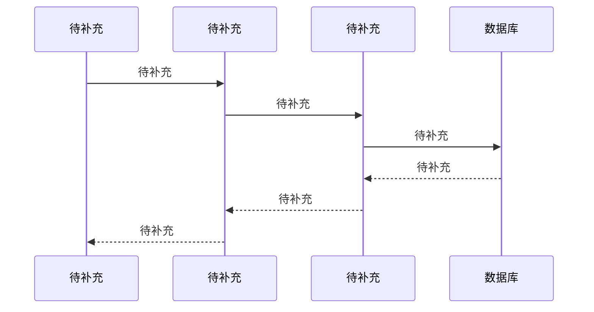

## 四、03-架构/

### 4.1 01-系统架构\<短名\>_vX.Y.Z_\<YYYYMMDD\>.md（**链上，带版本**）

**回答**：为了实现这个原型，技术上怎么搭。**这张文档只放文字、模块清单和流程时序图**；架构总览与系统上下文在 `02-架构图示.html`（见 4.2），状态机在 `03-状态机/`（见 4.3）。

> 模板外层用四个反引号，因为里面含 mermaid 代码块。复制到项目时改成三个反引号。

````markdown
# 系统架构

> **审查**：待审查 | 已通过（CR<N>，第 <N> 轮）| 退回修改
> **放行**：待确认 | 已放行 · <放行人> · <日期>
> **最后更新**：<YYYY-MM-DD>

## 一、定位与质量目标

待补充：一句话说清这套系统解决什么。

| # | 质量目标 | 数字 | 怎么验证 |
|---|---|---|---|
| 1 | 待补充 | 待补充 | 待补充 |
| 2 | 待补充 | 待补充 | 待补充 |
| 3 | 待补充 | 待补充 | 待补充 |

## 二、架构总览

待补充：分几层，一句话说清每层职责。

**逻辑架构图与系统上下文图都在 `02-架构图示.html`**，这里只写分层说明。

## 三、模块清单

| # | 模块 | 职责 | 对外接口 | 代码位置 |
|---|---|---|---|---|
| 1 | 待补充 | 待补充 | 待补充 | `src/待补充` |

**所有源码都要能落到某个模块里。** 落不进去，说明模块划分有漏洞。

## 四、核心流程

待补充：几条关键链路，每条**一张只画正常路径的时序图** + **一张失败分支表**。

### 4.1 待补充



**失败分支**

| 步 | 失败条件 | 返回 | 副作用 |
|---|---|---|---|
| 待补充 | 待补充 | 待补充 | 待补充 |

| 项 | 内容 |
|---|---|
| 事务边界 | 待补充 |
| 失败点 | 待补充 |
| 幂等 | 待补充 |

## 五、状态机

**图在 `03-状态机/1-<实体>_vX.Y.Z.html`（每个实体一张，文件名带序号与版本），这里只写文字定义。**

**每个有 `status` 列的实体各写一张表**，不许只写订单：

| 实体 | 状态数 | 终态 | 图文件 |
|---|---|---|---|
| 待补充 | 待补充 | 待补充 | `03-状态机/1-<实体>_vX.Y.Z.html` |

**这张表是状态机图的唯一导航。** 有哪几张、编号顺序是什么，全在这里；不建 `03-状态机/index.html`。

**合法迁移**（每个实体一张，逐条写「从 → 到，什么条件」）：

| 实体 | 从 | 到 | 条件 | 谁触发 |
|---|---|---|---|---|
| 待补充 | 待补充 | 待补充 | 待补充 | 待补充 |

**非法迁移**：一律抛错，不静默忽略。

**终态**：待补充（列出全部，且确认无出边）。

## 六、非功能设计

| 项 | 做法 |
|---|---|
| 性能 | 待补充 |
| 熔断与重试 | 待补充 |
| 降级 | 待补充 |
| 容量 | 待补充 |

## 七、风险与技术债

| 问题 | 影响 | 计划 |
|---|---|---|
| 待补充 | 待补充 | 待补充 |

最后更新：<YYYY-MM-DD>
````

**这张文档只留一种图：`sequenceDiagram`（调用顺序）。** 架构与上下文见图 4.2，状态机见图 4.3，ER 图见图 4.6。

**一张图回答一个问题：时序图只画正常路径，失败放表。** 把失败分支套进 `alt` 会让正常路径也读不清——这次实测 6.1 有 3 个 `alt`、6.4 有 6 个 `alt` + 1 个 `else`，读的人既看不出主流程也数不清失败有几种。

**只有一种例外**：分支本身改变了后续步骤的顺序（例如「仅退款」整条链路不同）。那种情况**拆成两张独立时序图**，不要用 `alt` 套在正常路径里。

**完成检查**

- [ ] 质量目标三条，都带数字和验证方式
- [ ] 模块清单的**内部模块数**与 `02-架构图示.html` 的非 `external` 节点数一致
- [ ] 每个模块有代码位置，没有源码落在清单外
- [ ] 每条核心流程一张时序图，**图里没有 `alt` / `else` / `opt`**，只有正常路径
- [ ] 每条流程紧跟一张「失败分支」表，列：步 / 失败条件 / 返回 / 副作用
- [ ] 每张时序图下面有三行：事务边界、失败点、幂等
- [ ] 状态机有文字定义（合法迁移逐条、非法组合、终态），**且每个有状态列的实体各自出图**
- [ ] 状态机表的「图文件」列填了带序号的文件名，且路径真实存在
- [ ] 非功能写了降级策略，不是只写目标

### 4.2 02-架构图示_vX.Y.Z.html（**链上，带版本**）

**这份图的「放行」跟随 `01-系统架构.md` 的门 3**，html 自身不单设放行行。

**由 Archify 生成，单个自包含 HTML，`architecture` 类型。**

**这张图同时讲两件事**：内部模块怎么分层、外部系统怎么连。外部系统用 `external` 类型，放在边界框外。

| 要求 | 说明 |
|---|---|
| 节点数 | **8–12 个**，超过就拆图 |
| 画布宽 | ≤ 1240px（宽高比 ≥ 1.55 时可到 1790px） |
| 节点类型 | 只能选：`frontend` `backend` `database` `cloud` `security` `messagebus` `external` |
| 边界 | `region` 或 `security-group`，必须表达真实隔离，不能只是把节点框起来 |
| 连线语义 | `emphasis` 主路径、`security` 策略/权限、`dashed` 异步、`default` 普通依赖 |
| 卡片 | 补充读者会问的问题，**不替代拓扑** |
| 交叉 | `visualReviewRecommendation` 信号为 0，或已按 hints 修过 |

**超过 12 节点时拆成目录，按「总览 + 域」分：**

```text
docs/03-架构/02-架构图示/
├─ 1-总览_v1.3.html      ← 只画分层与外部系统边界，不点具体模块
├─ 2-<域>_v1.3.html      ← 一个域一张，画该域模块与依赖
└─ 3-<域>_v1.3.html
```

**为什么按「总览 + 域」拆**：架构图有两类读者——新人先看总览（分层、边界、外部系统），改某个模块的人只看该域。1–12 节点时一张够；超了之后混在一起谁也读不清。

**不建 `index.html` 导航页。** 各域有哪几张，写在 `01-系统架构.md` 的模块清单里（每个域标明看哪张图），那里会被审查。

**产物清单**：`02-架构图示.html`（≤12 节点）或 `02-架构图示/`（>12 节点）。收据（`.finalize.json` / `.browser-check.json` / `.delivery.json` / `.finalize-summary.json`）全部进 `docs/99-tmp/架构-<任务>/receipts/`，用 `--out-dir` 指定。

**源 JSON 存 `docs/99-tmp/架构-<任务>/architecture.json`**，返工重跑用。

**文字版是事实源，图文不一致时以文字为准，图跟着改。**

**完成检查**

- [ ] 内部模块与 `01-系统架构.md` 的模块清单一一对应
- [ ] 外部系统用 `external` 且画在边界外
- [ ] 主路径能一眼看出（`emphasis` 连线）
- [ ] 边界表达真实隔离（区域 / 安全组），不是装饰框
- [ ] `finalize` 四校验全过
- [ ] `visualReviewRecommendation` 无未修交叉
- [ ] 单文件，浏览器能打开

### 4.3 03-状态机/ —— 每个有状态列的实体一张（文件名 `1-<实体>_vX.Y.Z.html`）

**这些图的「放行」跟随 `01-系统架构.md` 的门 3**，html 自身不单设放行行。

**由 Archify 生成，`lifecycle` 类型。**

**每个有状态的实体一张图，不合并。** 订单、发货单、售后单、退款单是四个实体，套在一张图里主路径会互相遮挡（渲染器按单一 `mainPath` 排布）。

```text
03-状态机/
├─ 1-订单_v1.3.html
├─ 2-发货单_v1.3.html
├─ 3-售后单_v1.3.html
└─ 4-退款单_v1.3.html
```

**和架构图示是两个文件，不能合成一个**——两者的 schema 完全不同（`components` vs `states`），一次 `finalize` 只能出一种。

| 字段 | 要求 |
|---|---|
| `mainPath` | 主流程的状态顺序，单独列出来；渲染器靠它排位置 |
| `states[].type` | 只能取：`start` `active` `waiting` `decision` `success` `failure` `neutral` `external` |
| `transitions` | 每条写 `from` / `to` / `label`；可恢复的失败要有真实回退迁移 |
| 终态 | 必须标出，且不再有出边 |

**产物清单**：每个实体一个 `.html` + `.finalize.json` + `.browser-check.json`，收据进 `docs/99-tmp/架构-<任务>/receipts/`

**源 JSON 存 `docs/99-tmp/架构-<任务>/lifecycle-<实体>.json`。**

**`01-系统架构.md` 第五节写文字定义（合法迁移表、非法组合、终态），这里出图。**

**完成检查**

- [ ] 每个有 `status` 列的实体都有一张状态机图，**不是只有订单**
- [ ] 所有状态都在，含终态
- [ ] `mainPath` 与主流程一致
- [ ] 终态没有出边
- [ ] 可恢复的失败有回退迁移
- [ ] 每个图文件 `finalize` 四校验全过

### 4.4 04-项目环境规范.md（**项目级，不带版本**）

**回答**：三套环境（本地开发、测试、生产）分别怎么配，差异只允许出现在一张表里。

**判断标准**：新人照着能跑起本地，运维照着能对上测试与生产；除了差异表，三套必须一致。

````markdown
# 项目环境规范

> **放行**：待确认 | 已放行 · <放行人> · <日期>
> **最后更新**：<YYYY-MM-DD>

## 一、工具版本

**版本精确到小版本号。** 写「Node 22」不够——22.11 与 22.13 在某些依赖解析上有差异。

| 工具 | 版本 | 怎么验证 | 为什么锁这个版本 |
|---|---|---|---|
| 待补充 | 待补充 | `待补充` | 待补充 |

**版本清单必须落成文件，不靠口头约定：**

| 文件 | 作用 |
|---|---|
| `.nvmrc` | Node 版本 |
| `package.json` 的 `engines` | Node 与包管理器下限 |
| `packageManager` 字段 | 包管理器精确版本 |
| `docker-compose.dev.yml` | 各依赖镜像 tag |

**禁止 `latest` 或浮动 tag。** 镜像写 `postgres:16.4`，不写 `postgres:16`。

## 二、端口与服务

### 2.1 本地端口

**一个端口一件事，全项目统一。**

| 服务 | 端口 | 地址 | 说明 |
|---|---|---|---|
| 前端 dev server | 待补充 | 待补充 | 待补充 |
| 后端 API | 待补充 | 待补充 | 待补充 |
| 数据库 | 待补充 | 待补充 | Docker 映射 |

**端口冲突改自己的启动参数，不改这份表。** 改表会让所有人的本地环境不一致。

### 2.2 三套环境的服务地址

| 服务 | 本地 | 测试 | 生产 |
|---|---|---|---|
| 前端 | 待补充 | 待补充 | 待补充 |
| 后端 | 待补充 | 待补充 | 待补充 |
| 数据库 | 待补充 | 待补充 | 待补充 |

## 三、三套环境总览

| 项 | 本地开发 | 测试环境 | 生产环境 |
|---|---|---|---|
| 谁用 | 待补充 | 待补充 | 待补充 |
| 机器 | 待补充 | 待补充 | 待补充 |
| 谁维护 | 待补充 | 待补充 | 待补充 |
| 怎么访问 | 待补充 | 待补充 | 待补充 |
| 数据 | 待补充 | 待补充 | 待补充 |
| 域名 | 待补充 | 待补充 | 待补充 |
| 部署方式 | 待补充 | 待补充 | 待补充 |
| 回滚 | 待补充 | 待补充 | 待补充 |

## 四、变量清单

**变量名与含义的唯一出处是 `docs/06-运维/01-服务详细情况.md` 的「变量清单」。** 这里只写本地怎么填。

| 变量 | 本地值 | 说明 |
|---|---|---|
| 待补充 | 待补充 | 待补充 |

**本地值可以写死在这里，因为它们是公开的。** 真实凭证只在服务器上，`deploy/env/` 整目录不入库。

## 五、环境差异

**差异只允许出现在这张表里。表里没有的项，三套环境必须一致。**

| 项 | 本地开发 | 测试环境 | 生产环境 |
|---|---|---|---|
| 依赖版本 | 待补充 | 待补充 | 待补充 |
| 外部服务 | 待补充 | 待补充 | 待补充 |
| 定时任务 | 待补充 | 待补充 | 待补充 |
| 日志级别 | 待补充 | 待补充 | 待补充 |
| 数据量 | 待补充 | 待补充 | 待补充 |
| 外部访问 | 待补充 | 待补充 | 待补充 |
| 备份 | 待补充 | 待补充 | 待补充 |

## 六、本地依赖启动

**外部依赖用 Docker 起，不要求每个人本机装数据库。**

```yaml
# deploy/docker/docker-compose.dev.yml
services:
  待补充:
    image: 待补充
    ports: ["待补充:待补充"]
    environment:
      待补充: 待补充
volumes:
  待补充:
```

**启动顺序**：待补充。后端启动时检查数据库连接，连不上直接退出并打印连接串。

## 七、代码风格工具

**工具配置即规范，不写进文档正文。**

| 工具 | 管什么 | 配置文件 |
|---|---|---|
| Prettier | 缩进、引号、换行 | `.prettierrc` |
| ESLint | 语法、潜在 bug、import 顺序 | `eslint.config.js` |
| TypeScript | 类型严格度 | `tsconfig.json` 的 `strict: true` |
| commitlint | 提交信息格式 | `commitlint.config.js` |
| lint-staged | 提交前检查 | `package.json` |

**不抄缩进几个空格。** 抄一份必然和配置文件漂移。

## 八、常见问题

| 现象 | 原因 | 怎么修 |
|---|---|---|
| 待补充 | 待补充 | 待补充 |

最后更新：<YYYY-MM-DD>
````

**三套环境都要写，不能只写本地。** 只写本地，测试和生产就靠口口相传。

**差异只有一张表。** 表外的项（语言版本、变量名、目录结构）三个环境必须一致，否则本地能跑、生产跑不起来。

**完成检查**

- [ ] 每个工具精确到小版本号，且有验证命令
- [ ] 版本锁在配置文件里，不是只写在文档
- [ ] 本地端口表覆盖所有服务，标了冲突处理
- [ ] 三套环境的服务地址都有
- [ ] 三套环境总览写了谁用、谁维护、怎么访问、怎么回滚
- [ ] 环境差异只有一张表
- [ ] 变量清单指向「服务详细情况」，不重复维护
- [ ] 外部依赖能用一条命令拉起

### 4.5 05-数据库设计\<短名\>_vX.Y.Z_\<YYYYMMDD\>.md（**链上，带版本**）

**回答**：这个库存什么、表怎么设计、什么规则数据库管不了、怎么改才安全。

````markdown
# 数据库设计

> **审查**：待审查 | 已通过（CR<N>，第 <N> 轮）| 退回修改
> **放行**：待确认 | 已放行 · <放行人> · <日期>
> **最后更新**：<YYYY-MM-DD>

## 一、概览

| 项 | 内容 |
|---|---|
| 数据库 | 待补充，版本待补充 |
| 负责模块 | 待补充 |
| 负责人 | 待补充（schema 变更需其批准） |
| 迁移工具 | 待补充，迁移文件在 `待补充` |

**结构从迁移文件生成，不手写。** 本文只写「从迁移文件读不出来的东西」：含义、不变量、保留策略、改动风险。

## 二、表结构图

**ER 图在 `06-ER图*.html`，由 Archify 生成，含全部物理字段。** 这里只写表和字段的**含义**。

**一张图最多 12 张表，超过必须拆成多个文件，并归到 `06-ER图/` 目录：** `06-ER图/1-<域>.html`、`06-ER图/2-<域>.html`。**恒为目录，不建 `index.html`。**

### 2.1 图缺口清单

**`schema` 里的每张表，要么出现在某张 ER 图里，要么在这张清单里写明为什么没画、在文字哪一节能查到。** 两个都不是 → 产物不合格。

**这张表就是 ER 图的唯一导航**——有哪几张图、哪张图画了什么，全在这里。不建 `06-ER图/index.html`。

| 表 | 状态 | 在哪个图文件 | 原因 | 文字在哪一节 |
|---|---|---|---|---|
| 待补充 | 已画 / 未画 | `06-ER图/1-<域>.html` | 待补充 | 待补充 |

**怎么核对**：从 `schema` 抽表名，与各图 JSON 的 entity `id` 做差集；差集必须为空，或差集里每个表都在上表里。

## 三、表清单

| 表 | 一行代表什么 | 当前行数 | 年增长 | 会不会删 |
|---|---|---|---|---|
| 待补充 | 待补充 | 待补充 | 待补充 | 待补充 |

## 四、字段与枚举含义

### 4.1 待补充（表名）

| 字段 | 类型 | 约束 | 默认 | 说明 |
|---|---|---|---|---|
| 待补充 | 待补充 | 待补充 | 待补充 | 待补充 |

**枚举值必须列全含义**，不写「见状态机」：

| 值 | 含义 | 谁能改到它 |
|---|---|---|
| 待补充 | 待补充 | 待补充 |

## 五、索引

**每个索引都要能说出服务于哪条查询。** 说不出就不要建。

| 索引 | 字段 | 服务的查询 | 为什么这样排 |
|---|---|---|---|
| 待补充 | 待补充 | 待补充 | 待补充 |

**冗余索引检查**：待补充。
**数量上限**：单表索引 ≤ 5。加到第 6 个要先说明理由。

## 六、不变量

**数据库约束表达不了的规则。** 不写，改代码的人不知道这些必须成立。

| # | 不变量 | 谁在保证 | 违反会怎样 |
|---|---|---|---|
| 1 | 待补充 | 待补充 | 待补充 |

## 七、数据分类与保留

| 表 / 字段 | 是不是个人信息 | 保留期 | 到期怎么处理 |
|---|---|---|---|
| 待补充 | 待补充 | 待补充 | 待补充 |

**软删还是硬删**：待补充。
**删除请求怎么处理**：待补充。

## 八、迁移与回滚

**每个迁移必须写清五段：改什么、影响多少行、锁多久、兼容窗口、怎么退。**

| 阶段 | 内容 | 影响行数 | 预计锁 | 耗时 |
|---|---|---|---|---|
| 待补充 | 待补充 | 待补充 | 待补充 | 待补充 |

**兼容窗口**：

| 迁移 | 旧代码能读新表吗 | 新代码能读旧数据吗 | 窗口多久 |
|---|---|---|---|
| 待补充 | 待补充 | 待补充 | 待补充 |

**回滚**：

| 迁移 | 回滚命令 | 回滚后数据 |
|---|---|---|
| 待补充 | 具体 SQL | 待补充 |

**回滚触发条件**：待补充：写成数字，例如 5xx 占比、P95 耗时。

**回滚前必须验证 down 迁移能跑通。** 只在测试库跑一次 up 不算验证。

## 九、容量与增长

| 表 | 当前 | 12 个月后 | 36 个月后 | 什么时候要动 |
|---|---|---|---|---|
| 待补充 | 待补充 | 待补充 | 待补充 | 待补充 |

**大表改动方案**：待补充：超过多少行后 ALTER 会锁表，改为怎样的五步走。

最后更新：<YYYY-MM-DD>
````

**结构和含义分开写。** 字段类型在迁移文件里，枚举含义、单位、时区只在本文里。

**不变量这一节最容易被跳过，也最贵。** 数据库约束管不到的规则，不写下来，改代码的人一定违反。

**迁移五段缺一不可**：改什么、影响多少行、锁多久、兼容窗口、怎么退。

**完成检查**

- [ ] 每张表写了「一行代表什么」
- [ ] 所有枚举值都列了含义，不是「见状态机」
- [ ] 金额、时间的单位与时区写清了
- [ ] 每个索引能说出服务于哪条查询
- [ ] 不变量至少 5 条，且写了「谁在保证」
- [ ] 数据分类标了哪些是个人信息，保留期与删除方式写了
- [ ] 迁移写了影响行数、锁、兼容窗口
- [ ] 回滚命令是具体 SQL，不是「可回滚」
- [ ] 大表写了什么时候该分区或分表

### 4.6 06-ER图/ —— 一张 8–12 表（文件名 `<N>-<域>_vX.Y.Z.html`）

**这些图的「放行」跟随 `01-系统架构.md` 的门 3**，html 自身不单设放行行。

**由 Archify 生成，table-first，显示每一个物理字段。** 不是「挑几个重要字段画一画」。

| 要求 | 说明 |
|---|---|
| 字段 | **全部物理列**，一个不漏 |
| 类型 | SQL 类型照实写（`bigserial`、`varchar(32)`、`timestamptz`） |
| 主外键 | `key` 取 `pk` / `fk` / `uk`；联表列写 `["pk","fk"]` |
| 外键指向 | 每个 `fk` 列都要 `references`，**且用 entity 的 `id` 不是表名**：`"user.id"` ✅ / `"users.id"` ❌ |
| 域分组 | 按功能域打 `tag`，且**同一张表必须同时写 `row` / `col`** |
| 空值 | 可空列标出来 |

**`references` 写错是最高频失败**：`label` 是全复数表名（`users`），`id` 是单数（`user`），`references` 只认 `id`。写错报 `layout/constraint | references unknown entity`。

**`row` / `col` 是硬要求，不是可选项。** 打了 `tag` 的表没有网格坐标就没法算色块范围，渲染器直接报 `erd/domain-not-drawn`。一个域的成员只能排成**一行、一列或实心矩形块**，不能 L 形或斜线。

**多域时一个域占一列最好读**——横向铺开会被缩放，纵向拉长反而保证完整。

```bash
node ~/.agents/skills/archify/bin/archify.mjs finalize erd \
  candidate.json 06-ER图/1-<域>.html --quality standard --json \
  --out-dir docs/99-tmp/架构-<任务>/receipts/
```

**超过 8 张表或 50 个字段时，第一遍用 `--quality standard`。** 只有布局仍然读得清时才升 `showcase`——别一上来追高，也不无限重试。

**产物清单**：每张图一个 `.html`；收据（`.finalize.json` / `.browser-check.json` / `.delivery.json` / `.finalize-summary.json`）全部进 `docs/99-tmp/架构-<任务>/receipts/`

**源 JSON 存 `docs/99-tmp/架构-<任务>/erd.json`。**

### 4.6.1 一次只画 8–12 张表：超出必须拆成多个图文件

**Archify 的硬约束：一次 `finalize` 只出一个 `<svg>`，8–12 个 entity 是单屏可读上限。** 22 张表塞一张里，字号会掉到读不清。

**正确处理是拆，不是「只画主干」。**

```text
06-ER图/
├─ 1-账号与商品_v1.3.html    （user / spu / sku / sku_spec / warehouse / stock / stock_ledger）
├─ 2-订单与发货_v1.3.html    （order / order_line / order_alloc / shipment / shipment_line / import_log）
└─ 3-售后与审计_v1.3.html    （after_sale / after_sale_alloc / refund / audit_log / session / doc_*）
```

**每个图文件都单独 `finalize`，收据进 `docs/99-tmp/架构-<任务>/receipts/`。**

**覆盖面对账（必做，不靠印象）**：

```bash
# 1. 从 schema 抽表名（先截出建表子句，再取表名；兼容 "order" 这种带引号的写法）
grep -Eo 'CREATE TABLE( IF NOT EXISTS)? *"?[a-zA-Z_][a-zA-Z0-9_]*"?' src/backend/db/schema.sql \
  | sed -E 's/CREATE TABLE( IF NOT EXISTS)? *"?([a-zA-Z_][a-zA-Z0-9_]*)"?/\2/' \
  | sort > /tmp/tables-schema.txt

# 2. 从各图 json 抽 entity id
python3 -c '
import glob, json
ids = set()
for f in glob.glob("docs/99-tmp/架构-<任务>/erd-*.json"):
    d = json.load(open(f, encoding="utf-8"))
    for e in d.get("entities", []):
        ids.add(e.get("id") or e.get("name"))
for i in sorted(ids):
    print(i)
' > /tmp/tables-erd.txt

# 3. 差集必须为空，或差集里每个表都在「图缺口清单」
comm -23 /tmp/tables-schema.txt /tmp/tables-erd.txt
```

**这条命令有两个坑，这次实测都踩到了：**

1. 用 `sed -E 's/.*"(.*)"|.* ([a-z_]+) \(.*/\1\2/'` 这种双分支替换，POSIX 的最左最长匹配会让 `order` 抽成 `order (`——表名多带了括弧，后面对不上。**抽表名要先 `grep -o` 截出建表子句再取名字**，不要靠一个巨大的替换正则。
2. `CREATE TABLE IF NOT EXISTS "order"` 这种带引号的表名必须单独处理，否则引号会留在名字里。

**差集非空且没写缺口清单 → 产物不合格。** 缺口清单写在 `05-数据库设计.md` 开头，每条写清：缺哪张表、为什么没画、在文字哪一节能查到。

**完成检查**

- [ ] 每张表的每个物理字段都在
- [ ] 主外键标全，外键有指向
- [ ] 每个带 `tag` 的表都有 `row` / `col`
- [ ] 域分组排成矩形块，不是 L 形
- [ ] **`schema.sql` 的表名与图上 entity 名的差集为空**，或差集里每张表都写进「图缺口清单」
- [ ] 单张图不超过 12 个 entity；超过时已拆成多个文件
- [ ] **「图缺口清单」每一行都填了「在哪个图文件」**，且路径真实存在
- [ ] 每个图文件 `finalize` 四校验全过；收据在 `99-tmp/.../receipts/`
- [ ] 目录里没有 `index.html` 导航页

### 4.7 07-ADR重要决策/ADR\<N\>_\<短名\>_vX.Y.Z_\<YYYYMMDD\>.md

**回答**：为什么当时这么选、放弃过什么、代价是什么。

四段，很短，不写实现日志。

```markdown
> **ADR<N>** · ADR · vX.Y.Z（**链版本**）· <YYYY-MM-DD>
> **放行**：待确认 | 已放行 · <放行人> · <日期>
> **ADR 状态**：accepted | proposed | superseded · <决定人> · <日期>

# 待补充

## 一、Context 背景

待补充：不这么干会出什么事。写具体现象，不写「为了提升质量」这种话。

## 二、Decision 决定

1. 待补充：可执行、可验证的一条。
2. 待补充
3. 待补充

## 三、Consequences 代价

- 好：待补充
- 好：待补充
- 坏：待补充（**必须有**）
- 坏：待补充

## 四、Alternatives 放弃过的选项

| 选项 | 做法 | 为什么不选 |
|---|---|---|
| A | 待补充 | 待补充 |
| B | **选中** | — |
| C | 待补充 | 待补充 |
```

**四段缺一不可**：Context / Decision / Consequences / Alternatives。

| 段 | 硬要求 |
|---|---|
| Context | 写清「不这么干会出什么事」，不是泛泛描述背景 |
| Decision | 编号列出，每条可执行、可验证 |
| Consequences | **至少一条坏处**，没有坏处的方案是没想清楚 |
| Alternatives | **至少两个**，且每个都写了为什么不选 |

**ADR 不写实现细节、不贴代码、不写测试结果。** 那些在 TD、实现记录和测试报告里。ADR 只回答「当时为什么这么定」。

**编号全局递增、永不复用。** `ADR7` 永远是那一条决策，即使被废弃。

**完成检查**

- [ ] Context 写了「不这么干会出什么事」
- [ ] Decision 是编号列表，每条可验证
- [ ] Consequences 至少一条坏处
- [ ] Alternatives 至少两个，都写了为什么不选
- [ ] 没有贴代码、没有写测试结果、没有实现步骤
- [ ] 文首状态为 `accepted` / `proposed` / `superseded` 之一

---
