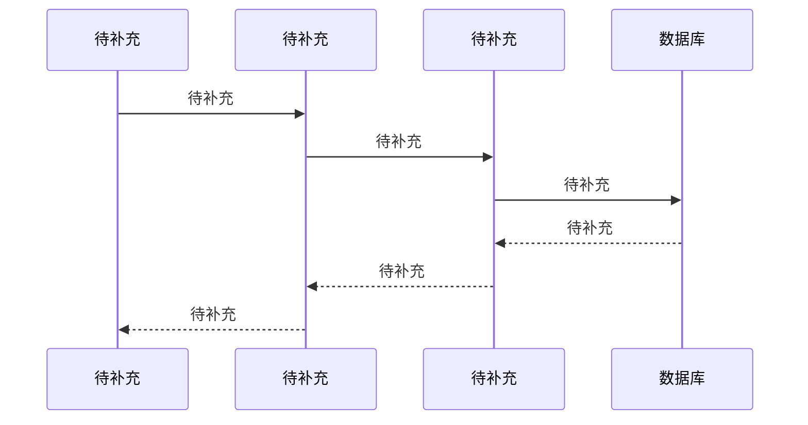

## 四、03-架构/

### 4.1 01-系统架构/01-<短名>_系统架构_v<版本>_<日期>.md（**链上，带版本**）

**回答**：为了实现这个原型，技术上怎么搭。**这张文档只放文字、模块清单和流程时序图**；架构总览与系统上下文在 `03-架构/02-架构图示/01-<短名>_总览_v<版本>.html`，状态机在 `03-架构/03-状态机/`。

````markdown
# 系统架构

> **审查**：待审查（随 CR2 在代码后）| 已通过（CR2）| 退回修改
> **放行（门 2A，代码前）**：待确认 | 已放行 · <放行人> · <日期>

## 一、本文结论

分几层、几个模块、三条质量目标各是什么数。

| 项 | 值 |
|---|---|
| 层数 | 待补充 |
| 内部模块 | 待补充 |
| 质量目标 | 待补充 |

## 二、定位与质量目标

待补充：一句话说清这套系统解决什么。

| # | 质量目标 | 数字 | 怎么验证 |
|---|---|---|---|
| 1 | 待补充 | 待补充 | 待补充 |
| 2 | 待补充 | 待补充 | 待补充 |
| 3 | 待补充 | 待补充 | 待补充 |

**只立能用数字判死的目标。** 「高性能」「稳定」不是目标；「复算偏差 0.000000」「UPDATE 被拒率 100%」是。**判不死的需求交给 AC，不占这三条名额。**

## 三、架构总览

待补充：分几层，一句话说清每层职责。

**逻辑架构图与系统上下文图都在 `03-架构/02-架构图示/01-<短名>_总览_v<版本>.html`**，这里只写分层说明。

**每层一句话写清「是不是真隔离」**：进程内模块调用不是隔离，网络边界才是。写错这一列，后面所有安全假设都建立在错的前提上。

## 四、模块清单

| # | 模块 | 职责 | 对外接口 | 代码位置 |
|---|---|---|---|---|
| 1 | 待补充 | 待补充 | 待补充 | `src/待补充` |

**所有源码都要能落到某个模块里。** 落不进去，说明模块划分有漏洞。

**跨模块只能调对方的对外接口，不许直接读对方的表或内部函数。** 违反就是架构禁令，CR2 会按这条查。

## 五、核心流程

待补充：几条关键链路，每条**一张只画正常路径的时序图** + **一张失败分支表**。

### 5.1 待补充



**失败分支**

| 步 | 失败条件 | 返回 | 副作用 |
|---|---|---|---|
| 待补充 | 待补充 | 待补充 | 待补充 |

| 项 | 内容 |
|---|---|
| 事务边界 | 待补充 |
| 失败点 | 待补充 |
| 幂等 | 待补充 |

## 六、状态机

**图在 `03-架构/03-状态机/01-<实体>_状态机_v<版本>.html`（每个实体一张，文件名带序号与版本），这里只写文字定义。**

**每个有 `status` 列的实体各写一张表**，不许只写订单：

| 实体 | 状态数 | 终态 | 图文件 |
|---|---|---|---|
| 待补充 | 待补充 | 待补充 | `03-架构/03-状态机/01-<实体>_状态机_v<版本>.html` |

**这张表是状态机图的唯一导航。** 有哪几张、编号顺序是什么，全在这里；不建 `03-架构/03-状态机/index.html`。

**合法迁移**（每个实体一张，逐条写「从 → 到，什么条件」）：

| 实体 | 从 | 到 | 条件 | 谁触发 |
|---|---|---|---|---|
| 待补充 | 待补充 | 待补充 | 待补充 | 待补充 |

**非法迁移**：一律抛错，不静默忽略。

**终态**：待补充（列出全部，且确认无出边）。

**终态判据写死**：终态栏所列状态，在「从」列里不许再出现。**一条违反就是状态机漏了终态。**

## 七、非功能设计

| 项 | 做法 | 出问题时的兜底 |
|---|---|---|
| 性能 | 待补充 | 待补充 |
| 熔断与重试 | 待补充 | 待补充 |
| 降级 | 待补充 | 待补充 |
| 容量 | 待补充 | 待补充 |

**每一行都要有兜底。** 只写目标不写兜底，等于把事故留给上线后的运维。

## 八、风险与技术债

| 编号 | 问题 | 影响 | 计划 |
|---|---|---|---|
| RK-01 | 待补充 | 待补充 | 待补充 |

**风险要编号**（`RK-NN`），TD 与 TR 都按这个号引用。不编号的风险，写完了没人跟。

````

### 4.2 02-架构图示/01-<短名>_总览_v<版本>.html（**链上，带版本**）

**这份图的「放行」跟随 `03-架构/01-系统架构/01-<短名>_系统架构_v<版本>_<日期>.md` 的门 2A**，html 自身不单设放行行。

**由 Archify 生成，单个自包含 HTML，`architecture` 类型。**

**这张图同时讲两件事**：内部模块怎么分层、外部系统怎么连。外部系统用 `external` 类型，放在边界框外。

| 要求 | 说明 |
|---|---|
| 节点数 | **8–12 个**，超过就拆图 |
| 画布宽 | ≤ 1240px（宽高比 ≥ 1.55 时可到 1790px） |
| 节点类型 | 只能选：`frontend` `backend` `database` `cloud` `security` `messagebus` `external` |
| 边界 | `region` 或 `security-group`，必须表达真实隔离，不能只是把节点框起来 |
| 连线语义 | `emphasis` 主路径、`security` 策略/权限、`dashed` 异步、`default` 普通依赖 |
| 卡片 | 补充读者会问的问题，**不替代拓扑** |
| 交叉 | `visualReviewRecommendation` 信号为 0，或已按 hints 修过 |

**超过 12 节点时拆成目录，按「总览 + 域」分：**

```text
docs/03-架构/02-架构图示/
├─ 01-<短名>_总览_v<版本>.html          ← 只画分层与外部系统边界，不点具体模块
├─ 02-<域>_模块与依赖_v<版本>.html      ← 一个域一张，画该域模块与依赖
└─ 03-<域>_模块与依赖_v<版本>.html
```

### 4.3 03-状态机/ —— 每个有状态列的实体一张（文件名 `01-<实体>_状态机_v<版本>.html`）

**这些图的「放行」跟随 `03-架构/01-系统架构/01-*.md` 的门 2A**，html 自身不单设放行行。

**由 Archify 生成，`lifecycle` 类型。**

**每个有状态的实体一张图，不合并。**。

```text
03-架构/03-状态机/
├─ 01-订单_状态机_v<版本>.html
├─ 02-发货单_状态机_v<版本>.html
├─ 03-售后单_状态机_v<版本>.html
└─ 04-退款单_状态机_v<版本>.html
```

**和架构图示是两个文件，不能合成一个**——两者的 schema 完全不同（`components` vs `states`），一次 `finalize` 只能出一种。

| 字段 | 要求 |
|---|---|
| `mainPath` | 主流程的状态顺序，单独列出来；渲染器靠它排位置 |
| `states[].type` | 只能取：`start` `active` `waiting` `decision` `success` `failure` `neutral` `external` |
| `transitions` | 每条写 `from` / `to` / `label`；可恢复的失败要有真实回退迁移 |
| 终态 | 必须标出，且不再有出边 |

### 4.4 04-项目环境规范/01-项目环境规范.md（**项目级，不带版本**）

**回答**：三套环境（本地开发、测试、生产）分别怎么配，差异只允许出现在一张表里。

**判断标准**：新人照着能跑起本地，运维照着能对上测试与生产；除了差异表，三套必须一致。

````markdown
# 项目环境规范

> **放行**：待确认 | 已放行 · <放行人> · <日期>
> **最后更新**：<YYYY-MM-DD>

## 一、本文结论

几套环境、各在哪、本地怎么起来。

| 项 | 值 |
|---|---|
| 环境数 | 待补充 |
| 本地依赖 | 待补充 |
| 启动命令 | 待补充 |

## 二、工具版本

**版本精确到小版本号。** 写「Node 22」不够——22.11 与 22.13 在某些依赖解析上有差异。

| 工具 | 版本 | 怎么验证 | 为什么锁这个版本 |
|---|---|---|---|
| 待补充 | 待补充 | `待补充` | 待补充 |

**版本清单必须落成文件，不靠口头约定：**

| 文件 | 作用 |
|---|---|
| `.nvmrc` | Node 版本 |
| `package.json` 的 `engines` | Node 与包管理器下限 |
| `packageManager` 字段 | 包管理器精确版本 |
| `docker-compose.dev.yml` | 各依赖镜像 tag |

**禁止 `latest` 或浮动 tag。** 镜像写 `postgres:16.4`，不写 `postgres:16`。

## 三、端口与服务

### 3.1 本地端口

**一个端口一件事，全项目统一。**

| 服务 | 端口 | 地址 | 说明 |
|---|---|---|---|
| 前端 dev server | 待补充 | 待补充 | 待补充 |
| 后端 API | 待补充 | 待补充 | 待补充 |
| 数据库 | 待补充 | 待补充 | Docker 映射 |

**端口冲突改自己的启动参数，不改这份表。** 改表会让所有人的本地环境不一致。

### 3.2 三套环境的服务地址

| 服务 | 本地 | 测试 | 生产 |
|---|---|---|---|
| 前端 | 待补充 | 待补充 | 待补充 |
| 后端 | 待补充 | 待补充 | 待补充 |
| 数据库 | 待补充 | 待补充 | 待补充 |

## 四、三套环境总览

| 项 | 本地开发 | 测试环境 | 生产环境 |
|---|---|---|---|
| 谁用 | 待补充 | 待补充 | 待补充 |
| 机器 | 待补充 | 待补充 | 待补充 |
| 谁维护 | 待补充 | 待补充 | 待补充 |
| 怎么访问 | 待补充 | 待补充 | 待补充 |
| 数据 | 待补充 | 待补充 | 待补充 |
| 域名 | 待补充 | 待补充 | 待补充 |
| 部署方式 | 待补充 | 待补充 | 待补充 |
| 回滚 | 待补充 | 待补充 | 待补充 |

## 五、变量清单

**变量名与含义的唯一出处是 `docs/06-运维/01-服务详细情况/01-服务详细情况.md` 的「变量清单」。** 这里只写本地怎么填。

| 变量 | 本地值 | 说明 |
|---|---|---|
| 待补充 | 待补充 | 待补充 |

**本地值可以写死在这里，因为它们是公开的。** 真实凭证只在服务器上，`deploy/env/` 整目录不入库。

## 六、环境差异

**差异只允许出现在这张表里。表里没有的项，三套环境必须一致。**

| 项 | 本地开发 | 测试环境 | 生产环境 |
|---|---|---|---|
| 依赖版本 | 待补充 | 待补充 | 待补充 |
| 外部服务 | 待补充 | 待补充 | 待补充 |
| 定时任务 | 待补充 | 待补充 | 待补充 |
| 日志级别 | 待补充 | 待补充 | 待补充 |
| 数据量 | 待补充 | 待补充 | 待补充 |
| 外部访问 | 待补充 | 待补充 | 待补充 |
| 备份 | 待补充 | 待补充 | 待补充 |

## 七、本地依赖启动

**外部依赖用 Docker 起，不要求每个人本机装数据库。**

```yaml
# deploy/docker/docker-compose.dev.yml
services:
  待补充:
    image: 待补充
    ports: ["待补充:待补充"]
    environment:
      待补充: 待补充
volumes:
  待补充:
```

**启动顺序**：待补充。后端启动时检查数据库连接，连不上直接退出并打印连接串。

## 八、代码风格工具

**工具配置即规范，不写进文档正文。**

| 工具 | 管什么 | 配置文件 |
|---|---|---|
| Prettier | 缩进、引号、换行 | `.prettierrc` |
| ESLint | 语法、潜在 bug、import 顺序 | `eslint.config.js` |
| TypeScript | 类型严格度 | `tsconfig.json` 的 `strict: true` |
| commitlint | 提交信息格式 | `commitlint.config.js` |
| lint-staged | 提交前检查 | `package.json` |

**不抄缩进几个空格。** 抄一份必然和配置文件漂移。

````

### 4.5 05-数据库设计/01-<短名>_数据库设计_v<版本>_<日期>.md（**链上，带版本**）

**回答**：这个库存什么、每张表怎么设计、什么规则库管不了、怎么改才安全。

````markdown
# 数据库设计

> **审查**：待审查 | 已通过（CR2）| 退回修改
> **放行（门 2A，代码前）**：待确认 | 已放行 · <放行人> · <日期>

## 一、本文结论

几张表、几条不变量、能不能退。

| 项 | 值 |
|---|---|
| 物理表 | 待补充 |
| 不变量 | 待补充（`INV-01`…`INV-<N>`） |
| 能不能退 | 待补充：每个迁移都有 down，或写出哪个不可逆 |

**「能不能退」这一格必须填具体的。** 写「可回滚」不算——要写「9 个迁移全部有 down SQL，其中 `0005` 的回滚会丢数据，需先备份」。

## 二、全局约定

**所有表共用的约定，写一次，逐表不再重复。这一节错了，后面每条 SQL 都要改。**

| 项 | 约定 | 为什么 |
|---|---|---|
| 数据库与版本 | 待补充 | 待补充（如「依赖 PG 15+ 的部分唯一索引」） |
| 字符集与排序 | 待补充 | 待补充（如「`lc_collate=C`，避免排序随机器 locale 变化」） |
| 主键策略 | 待补充 | 待补充（如「实体表 `id UUID`，流水表用业务号」） |
| 时间 | 待补充 | 待补充（如「`timestamptz` UTC 存，展示按 `Asia/Shanghai`」） |
| **金额精度** | 待补充 | 待补充（如「元 `numeric(14,2)`；quota `numeric(18,6)`」） |
| 连接账号与权限 | 待补充 | 待补充（如「迁移角色有 DDL，应用角色无 UPDATE 权限」） |
| 迁移工具与执行方式 | 待补充 | 待补充（如「golang-migrate；启动不自动迁移，部署脚本显式调用」） |

**结构与含义分开写**：字段类型在迁移文件里；枚举含义、单位、时区、不变量只在本文。

## 三、表清单

**一张表一行。这张表是导航，也是 schema 变更的责任表。**

| # | 表 | 一行代表什么 | 归属模块 | 当前行数 | 年增长 | 会不会删 |
|---|---|---|---|---|---|---|
| 1 | 待补充 | 待补充 | 待补充 | 待补充 | 待补充 | 待补充 |

**「归属模块」不能空。** schema 变更要知道找谁批——Janus 那种 26 张表、跨 10 个模块的项目，没有这一列就没人认领。

## 四、逐表设计

**每张表一节，五样缺一不可**：字段表、枚举表、索引、设计理由、与上游不一致处。

**表多的按模块分组建节**（如「4.1 账号与供给」「4.2 计费与用量」），不按字母表排。

---

### 4.1 <表名>

**一句话**：待补充：这张表存什么、谁往里写、谁读。

#### 4.1.1 字段

| 字段 | 类型 | 约束 / 默认 | 说明 |
|---|---|---|---|
| 待补充 | 待补充 | 待补充 | 待补充 |

**说明列只写「从字段名看不出来的」**：归属关系、单位、谁改它、为什么这个类型。**能看懂的不要写。**

#### 4.1.2 枚举值

**枚举必须列全含义，不写「见状态机」。**

| 值 | 中文含义 | 谁能改到它 |
|---|---|---|
| 待补充 | 待补充 | 待补充 |

#### 4.1.3 索引

**每个索引都要说出服务于哪条查询。说不出就不要建，写了中期会变成维护负担。**

| 索引 | 字段 | 服务的查询 | 为什么这样排 |
|---|---|---|---|
| 待补充 | 待补充 | 待补充 | 待补充 |

**部分唯一索引的 `WHERE` 子句必须与状态机一致。** 状态机改了、`WHERE` 没改，唯一性会突然放开——这是最难查的一类 bug。

#### 4.1.4 设计理由

**散文一两句**：为什么这样拆、为什么不用另一种。

> **示例**
> 资金账本只增不改：唯一出口是 `FundsLedger.Append()`，应用角色**没有** UPDATE / DELETE 权限。
> 不用「余额字段 + 流水」两表，因为两者必然对不上，而对不上时无法判断哪个是对的。

#### 4.1.5 与上游不一致处

**PRD 说的和这里做的对不上时，写清「上游怎么写、这里怎么做、为什么」，并写进架构的差异清单。**

| 上游怎么写 | 这里怎么做 | 为什么 |
|---|---|---|
| 待补充 | 待补充 | 待补充 |

没有不一致就写「无」。**这一栏不写，后人会按上游那个错的版本改回来。**

---

### 4.2 <表名>

（同 4.1 的五样。）

## 五、跨表约束与不变量

**数据库约束表达不了的规则。不写，改代码的人不知道这些必须成立。**

| # | 不变量 | 谁在保证 | 违反会怎样 |
|---|---|---|---|
| INV-01 | 待补充 | 待补充 | 待补充 |

**不变量要编号**（`INV-NN`），TR 的不变量探针按这个号逐条打红。**只写「有约束」不写编号，测试就不知道要验几条。**

**每条都要写「谁在保证」**：库约束、应用层、定时任务、还是人工。写「应用层」的，说明库拦不住——改代码的人必须知道这一点。

## 六、数据分类与保留

| 表 / 字段 | 是不是个人信息 | 保留期 | 到期怎么处理 |
|---|---|---|---|
| 待补充 | 待补充 | 待补充 | 待补充 |

**软删还是硬删**：待补充。
**删除请求怎么处理**：待补充。
**导出包含哪些**：待补充。

## 七、迁移与回滚

**每个迁移必须写清五段：改什么、影响多少行、锁多久、兼容窗口、怎么退。**

| 迁移文件 | 改什么 | 影响行数 | 预计锁 | 耗时 |
|---|---|---|---|---|
| `0001_*.up.sql` | 待补充 | 待补充 | 待补充 | 待补充 |

**兼容窗口**：

| 迁移 | 旧代码能读新表吗 | 新代码能读旧数据吗 | 窗口多久 |
|---|---|---|---|
| 待补充 | 待补充 | 待补充 | 待补充 |

**回滚**：

| 迁移 | 回滚命令 | 回滚后数据 |
|---|---|---|
| 待补充 | 具体 SQL | 待补充 |

**回滚触发条件**：待补充：写成数字，例如 5xx 占比、P95 耗时。

**回滚前必须验证 down 迁移能跑通。** 只在测试库跑一次 up 不算验证。

## 八、容量与大表演进

| 表 | 当前 | 12 个月后 | 36 个月后 | 什么时候要动 |
|---|---|---|---|---|
| 待补充 | 待补充 | 待补充 | 待补充 | 待补充 |

**大表改动方案**：待补充：超过多少行后 ALTER 会锁表，改为怎样的五步走（加可空列 → 双写 → 回填 → 切读 → 删旧列）。

## 九、与 ER 图的对账

**ER 图在 `03-架构/06-ER图/`（`erd` 类型，table-first，含全部物理字段），恒为目录，不建 `index.html`。**

**对账只有一条判据**：`schema` 里的每张表，要么出现在某张 ER 图里，要么在 `03-架构/06-ER图` 的缺口清单里写明为什么没画。

**怎么核对**：从 `schema` 抽表名，与各图 JSON 的 entity `id` 做差集；差集必须为空，或差集里每个表都有缺口记录。

| 项 | 值 |
|---|---|
| 本版物理表 | 待补充 |
| 图上覆盖 | 待补充 |
| 缺口 | 待补充：无 / N 张，清单见 `03-架构/06-ER图/` |

````


### 4.6 06-ER图/ —— 一张 8–12 表（文件名 `01-<域>_ER图_v<版本>.html`）

**这些图的「放行」跟随 `03-架构/01-系统架构/01-*.md` 的门 2A**，html 自身不单设放行行。

**由 Archify 生成，table-first，显示每一个物理字段。** 不是「挑几个重要字段画一画」。

| 要求 | 说明 |
|---|---|
| 字段 | **全部物理列**，一个不漏 |
| 类型 | SQL 类型照实写（`bigserial`、`varchar(32)`、`timestamptz`） |
| 主外键 | `key` 取 `pk` / `fk` / `uk`；联表列写 `["pk","fk"]` |
| 外键指向 | 每个 `fk` 列都要 `references`，**且用 entity 的 `id` 不是表名**：`"user.id"` ✅ / `"users.id"` ❌ |
| 域分组 | 按功能域打 `tag`，且**同一张表必须同时写 `row` / `col`** |
| 空值 | 可空列标出来 |

**`references` 写错是最高频失败**：`label` 是全复数表名（`users`），`id` 是单数（`user`），`references` 只认 `id`。写错报 `layout/constraint | references unknown entity`。

**`row` / `col` 是硬要求，不是可选项。** 打了 `tag` 的表没有网格坐标就没法算色块范围，渲染器直接报 `erd/domain-not-drawn`。一个域的成员只能排成**一行、一列或实心矩形块**，不能 L 形或斜线。

**多域时一个域占一列最好读**——横向铺开会被缩放，纵向拉长反而保证完整。

```bash
node ~/.agents/skills/archify/bin/archify.mjs finalize erd \
  candidate.json 03-架构/06-ER图/01-<域>_ER图_v<版本>.html --quality standard --json \
  --out-dir docs/99-tmp/架构-<任务>/03-receipts/
```

**超过 8 张表或 50 个字段时，第一遍用 `--quality standard`。** 只有布局仍然读得清时才升 `showcase`——别一上来追高，也不无限重试。

**一次只画 8–12 张表：超出必须拆成多个图文件**

**Archify 的硬约束：一次 `finalize` 只出一个 `<svg>`，8–12 个 entity 是单屏可读上限。** 22 张表塞一张里，字号会掉到读不清。

**正确处理是拆，不是「只画主干」。**

```text
03-架构/06-ER图/
├─ 01-账号与商品_ER图_v<版本>.html    （user / spu / sku / sku_spec / warehouse / stock / stock_ledger）
├─ 02-订单与发货_ER图_v<版本>.html    （order / order_line / order_alloc / shipment / shipment_line / import_log）
└─ 03-售后与审计_ER图_v<版本>.html    （after_sale / after_sale_alloc / refund / audit_log / session / doc_*）
```

### 4.7 07-ADR重要决策/ADR<N>/01-<短名>_ADR_v<版本>_<日期>.md（**链上，带版本**）

**回答**：为什么当时这么选、放弃过什么、代价是什么。

```markdown
# ADR<N> · <决策短名>

> **ADR<N>** · ADR · vX.Y.Z（**链版本**）· <YYYY-MM-DD>
> **放行**：待确认 | 已放行 · <放行人> · <日期>
> **ADR 状态**：accepted | proposed | superseded · <决定人> · <日期>

## 一、本文结论

选了什么、放弃了什么、代价是什么。

| 项 | 值 |
|---|---|
| 选了什么 | 待补充 |
| 为什么不是另一个 | 待补充 |
| 代价 | 待补充 |

## 二、背景

待补充：不这么干会出什么事。写具体现象，不写「为了提升质量」这种话。

## 三、决定

1. 待补充：可执行、可验证的一条。
2. 待补充
3. 待补充

## 四、代价

- 好：待补充
- 好：待补充
- 坏：待补充（**必须有**）
- 坏：待补充

## 五、放弃过的选项

| 选项 | 做法 | 为什么不选 |
|---|---|---|
| A | 待补充 | 待补充 |
| B | **选中** | — |
| C | 待补充 | 待补充 |
```
